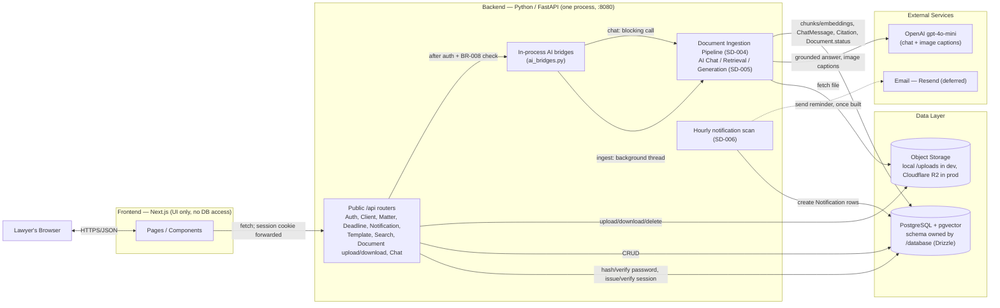
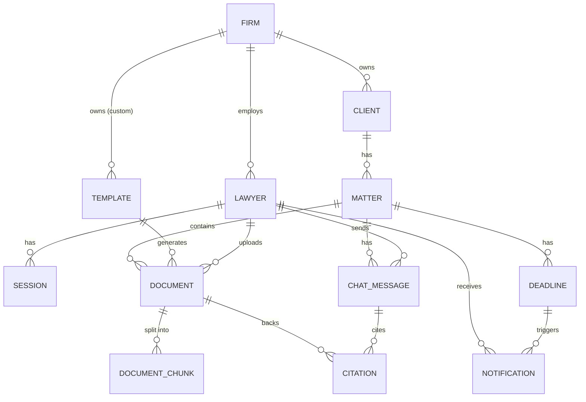

# System Architecture — Legal AI Assistant

Traces to [02-Requirements.md](02-Requirements.md). Solo/self-funded/low-budget constraint (Charter §5) drives every choice below toward fewer moving parts and lower ops burden over raw scalability — this system needs to comfortably serve NFR-006's target (≥50 concurrent Matters × 500 Documents), not thousands of tenants.

**A UI-only frontend and one backend.** Next.js is UI-only — it owns no business logic, no database connection, and no API routes of its own; every read/write goes to the backend over HTTP (explicit user requirement). The backend is one **Python (FastAPI)** process that owns everything server-side: auth and all CRUD — Firm/Client/Matter/Deadline/Notification/Template/Search — **and** everything AI: document ingestion (OCR → chunk → embed) and the AI Chat retrieval/generation pipeline. Its Postgres schema is owned by a standalone migration tool, not the backend — see §3.

> **History.** From V0.1 until 2026-11-20 the backend was split by language: Java (Spring Boot) for auth/CRUD on `:8080`, Python (FastAPI) for AI on `:8000`, with Java calling Python over HTTP after its own auth/BR-008 check. The Java service was ported to Python with response-for-response parity — same `/api` paths, shapes, status codes, cookie and port — so the frontend needed no change (Technology Decision Log, 2026-11-20). The module boundaries below (SD-001…SD-009) are unchanged; only where they live moved.

## 1. Architecture Diagram



Dotted edges are not built yet. OCR (EasyOCR) and embeddings (`all-MiniLM-L6-v2`) run locally inside the backend process; OpenAI is the only external API.

**Read path (Client/Matter/etc.):** Browser → Next.js (Server Component, forwarding the session cookie, or a client-side `fetch`) → backend `/api` → Postgres → back up the chain.

**Auth path:** Browser → Next.js → backend `/api/auth/*` → Postgres (`lawyers`/`sessions` tables) → `Set-Cookie` back to the browser (§5).

**Chat query path:** Browser → Next.js → backend `/api/matters/:id/chat` (auth + BR-008 Matter-ownership check, same as every other endpoint) → in-process `ChatGateway` → AI Chat (hybrid retrieval over `document_chunks` → LLM grounded answer → persists `ChatMessage`/`Citation`) → back up the chain. Blocking, since the browser is waiting on an answer. The AI module's own routes (`/chat/:matterId`, `/ingest/:documentId`) carry no auth of their own, so they are **not mounted** on the browser-facing app (opt-in via `EXPOSE_INTERNAL_AI_ROUTES`, for debugging only); `/api` calls the same router functions directly.

**Write path (document upload):** Browser → Next.js → backend `POST /api/matters/:id/documents` (stores the file, creates the `Document` row, sets `processing`) → starts ingestion on a background thread and returns `201` immediately → ingestion extracts/OCRs, chunks, embeds, writes `DocumentChunk` rows → `Document.status` becomes `'ready'` (or `'failed'` with `error_message`). The frontend learns of the change by re-fetching.

## 2. Modules / Components

| ID | Module | Lives in | Responsibility | Does NOT do |
|---|---|---|---|---|
| SD-001 | Web/UI Layer | Next.js (frontend) | Renders all 16 screens (UX doc §1); calls the backend `/api`; owns client-side empty/error/loading states. | No direct DB or storage access — not even for Server Components; everything goes through an HTTP call to the backend. |
| SD-002 | API Layer | Backend — `app/web/api/*_routes.py` | REST endpoints for every CRUD entity; validates input; enforces Firm-level data isolation (BR-008) on every query. | No business-rule decisions beyond request validation — those live in the owning module's domain/application layer. |
| SD-003 | Auth Module | Backend — `AuthService`, `BcryptPasswordHasher`, `SqlSessionRepository` | Owns password hashing (bcrypt, cost 12) and session issuance/verification end to end: register/login create a `Session` row and set an httpOnly cookie; every request resolves that cookie to a `Lawyer` row and `firm_id` (`resolve_lawyer`, called explicitly per handler); logout deletes the `Session` row. | Does not delegate credential storage or session validity to any third party — this module is the sole authority on both. |
| SD-004 | Document Ingestion Pipeline | Backend — `IngestionService` (AI) | Triggered in-process right after upload (`InProcessIngestionTrigger`, a background thread — §6); fetches the file from storage, extracts text (native PDF/DOCX) or OCRs it (EasyOCR, image-based content), splits it into chunks, generates embeddings (`all-MiniLM-L6-v2`), writes `DocumentChunk` rows, updates `Document.status` (REQ-004, NFR-002). | Does not own the `Document` row's initial creation or the upload endpoint (SD-002 / `DocumentService`). Not queue-based (§7). |
| SD-005 | AI Chat Module | Backend — `ChatService` (AI), fronted by `/api`'s auth/BR-008 gate | Retrieves relevant `DocumentChunk`s for a Matter only (BR-005), builds a grounded prompt, calls the LLM, verifies citations against `Citation` rows, persists the `ChatMessage`. Returns "not found" rather than fabricating when retrieval has no relevant chunks (REQ-007, BR-006). Reached only through `MatterChatService` → `InProcessChatGateway`. | Does not ingest documents (SD-004), answer questions using another Matter's chunks, or verify sessions (SD-003's job). |
| SD-006 | Deadline & Notification Module | Backend — `DeadlineService`, `NotificationService`, `NotificationScanService` + `NotificationScanScheduler` | CRUD on `Deadline`; the hourly scanner that creates `Notification` rows (email delivery deferred); enforces BR-003 (blocks `Matter.close` while open Deadlines exist, returning the specific blocking Deadlines). | Does not send arbitrary/marketing email — only Deadline reminders. |
| SD-007 | Template / Draft Generation Module | Backend — `TemplateService`, `DraftGenerationService` | Renders a `Template` with lawyer-supplied field values into a new `Document` (`is_draft=true`), then hands it to SD-004 like any other upload so it becomes queryable (REQ-015, REQ-020). | Does not create templates from user free text — templates are pre-authored. |
| SD-008 | Storage Module | Backend — `StorageService` port | `LocalFilesystemStorage` in dev (no R2 credentials available, §6), stores under `/uploads` keyed by a random UUID + original extension; ingestion reads the same directory through `LocalFileStorage`. A future R2 implementation satisfies the same port for production. | Not a document viewer/renderer. |
| SD-009 | Search Module | Backend — `SearchService`, `RecentSearchService` | Cross-entity search over `Client`/`Matter` (REQ-011) using Postgres full-text search — no separate search engine at this scale. | Does not search inside Document content — that's the Chat Module's job (BR-005 keeps it Matter-scoped). |

**Table ownership inside the one backend.** The CRUD modules read/write `firms`/`lawyers`/`sessions`/`clients`/`matters`/`deadlines`/`notifications`/`templates`/`documents`/`matter_views`/`recent_searches`/`lawyer_preferences`; the AI modules own `document_chunks`/`chat_messages`/`citations` plus updating `documents.status`. The one deliberate crossing is the Client/Matter cascade delete, which bulk-deletes a Matter's `chat_messages` (CLAUDE.md §4). Keeping this boundary is why the AI modules stayed byte-for-byte unchanged through the 2026-11-20 port.

## 3. Database Schema

PostgreSQL 16, one schema, `pgvector` extension enabled. Every tenant-owned table carries `firm_id` (directly or via its parent) to make BR-008 isolation a single indexed predicate rather than a multi-join check.

**Schema ownership:** lives in `/database` at the repo root (Drizzle schema + migrations, kept purely as a CLI migration tool — no longer part of an application's dependency tree, since the backend's runtime never touches Drizzle). The backend's raw-SQL repositories (`app/infrastructure/persistence/`, plus the AI module's own) only read/write these tables — nothing in the backend creates or alters one; everything maps onto what `/database`'s migrations already produced. This keeps exactly one tool authoring schema changes regardless of the backend's language (it already survived a Java → Python change untouched).



| Entity | Field | Type | Notes |
|---|---|---|---|
| **Firm** | id | uuid PK | |
| | name | text | |
| | created_at | timestamptz | |
| **Lawyer** | id | uuid PK | self-generated |
| | firm_id | uuid FK → Firm | |
| | name | text | |
| | email | text, unique | |
| | password_hash | text | bcrypt, cost 12 — never returned by any API response |
| | role | enum('owner','member') | owner can't be removed (SCR-15) |
| | created_at | timestamptz | |
| **Session** | id | uuid PK | |
| | lawyer_id | uuid FK → Lawyer | |
| | token_hash | text, unique | SHA-256 of the opaque token stored in the cookie — the raw token is never persisted |
| | expires_at | timestamptz | fixed 7-day expiry from creation |
| | created_at | timestamptz | |
| **Client** | id | uuid PK | |
| | firm_id | uuid FK → Firm | BR-008 |
| | name | text | required |
| | contact_email | text, nullable | |
| | contact_phone | text, nullable | |
| | notes | text, nullable | |
| | created_at / updated_at | timestamptz | |
| **Matter** | id | uuid PK | |
| | firm_id | uuid FK → Firm | BR-008 |
| | client_id | uuid FK → Client | BR-001 |
| | title | text | required |
| | status | enum('open','closed') | BR-003 |
| | closed_at | timestamptz, nullable | |
| | created_at / updated_at | timestamptz | |
| **Document** | id | uuid PK | |
| | matter_id | uuid FK → Matter | BR-002 |
| | uploaded_by | uuid FK → Lawyer | |
| | file_name | text | |
| | storage_key | text | R2 object key |
| | mime_type | text | |
| | size_bytes | bigint | |
| | status | enum('uploading','processing','ready','failed') | REQ-004 |
| | is_draft | boolean, default false | REQ-020 |
| | source_template_id | uuid FK → Template, nullable | REQ-015 |
| | error_message | text, nullable | shown on SCR-09 retry state |
| | created_at | timestamptz | |
| **DocumentChunk** | id | uuid PK | |
| | document_id | uuid FK → Document, `ON DELETE CASCADE` | deleting a Document (REQ-027) automatically removes its chunks at the DB level — the CRUD modules never manipulate `document_chunks` directly, preserving the CRUD/AI ownership boundary (§2) |
| | page_number | int, nullable | for citations (REQ-006) |
| | content | text | extracted chunk text |
| | embedding | vector(384) | dimension fixed by `all-MiniLM-L6-v2` (§6) |
| | created_at | timestamptz | |
| **Deadline** | id | uuid PK | |
| | matter_id | uuid FK → Matter | BR-004 |
| | title | text | required |
| | due_date | date | required |
| | status | enum('open','complete') | BR-003 |
| | notification_lead_days | int, default 3 | REQ-016 |
| | created_at / updated_at | timestamptz | |
| **Notification** | id | uuid PK | |
| | lawyer_id | uuid FK → Lawyer | recipient |
| | deadline_id | uuid FK → Deadline | |
| | message | text | |
| | sent_at | timestamptz, nullable | |
| | read_at | timestamptz, nullable | |
| | created_at | timestamptz | |
| **ChatMessage** | id | uuid PK | |
| | matter_id | uuid FK → Matter | BR-005 |
| | lawyer_id | uuid FK → Lawyer, nullable | null when role='assistant' |
| | role | enum('user','assistant') | |
| | content | text | |
| | created_at | timestamptz | |
| **Citation** | id | uuid PK | |
| | chat_message_id | uuid FK → ChatMessage, `ON DELETE CASCADE` | a Citation can't outlive its ChatMessage |
| | document_id | uuid FK → Document, nullable, `ON DELETE SET NULL` | REQ-027 lets a Document be deleted unconditionally; a Citation survives that as the historical record (AI Architecture §4, "persisted permanently") rather than being deleted or blocking the Document delete |
| | page_number | int, nullable | |
| | excerpt | text, nullable | quoted snippet backing the claim (BR-006) |
| | created_at | timestamptz | |
| **Template** | id | uuid PK | |
| | firm_id | uuid FK → Firm, nullable | null = system template, set = firm-custom |
| | name | text | |
| | description | text, nullable | |
| | body | text | placeholder-bearing template content |
| | created_at | timestamptz | |

## 4. API Design

Served by the **backend** (`backend-python`, `http://localhost:8080` in dev; Next.js has no API routes of its own). All routes under `/api`, JSON in/out, all require an authenticated session (§5) except `/api/auth/register` and `/api/auth/login`. Every list/detail route implicitly filters by the caller's `firm_id` (BR-008); a record outside the caller's Firm returns 404, never 403, to avoid confirming its existence. CORS is configured to allow the Next.js origin specifically, with credentials enabled, since the frontend now calls this API cross-origin rather than through same-origin Next.js API routes.

The contract below (paths, request/response shapes, status codes) is unchanged from before the Java migration — "no functionality should change" means the frontend's calls needed no reshaping, only a different base URL and explicit credential forwarding — with one addition: `GET /api/auth/me`. It didn't exist before because Server Components could call `getCurrentLawyer()` directly, in-process; once the frontend has no DB access, knowing "who am I" for page rendering requires a real network round-trip. Same data as always (a lawyer's own identity), new access path — not new functionality.

The 2026-11-20 Java → Python port kept this contract byte-compatible too — verified by running one 189-step request script against both backends and diffing the normalized responses (Technology Decision Log). Error bodies: `{ error: { code, message } }` for every handled error; framework-level failures (malformed UUID/date/int, missing param or body, unknown route, wrong method, wrong Content-Type) keep Spring's `{ timestamp, status, error, path }` shape with 400/404/405/415. Instants serialize as ISO-8601 UTC with a trailing `Z`; dates as `YYYY-MM-DD`.

| Method | Path | Request | Response | Status codes |
|---|---|---|---|---|
| POST | `/api/auth/register` | `{ name, email, password }` | `{ lawyer: Lawyer }` (sets session cookie); creates a new `Firm` + `Lawyer` (`role='owner'`) | 201, 400, 409 |
| POST | `/api/auth/login` | `{ email, password }` | `{ lawyer: Lawyer }` (sets session cookie) | 200, 400, 401 |
| GET | `/api/auth/me` | — | `{ lawyer: Lawyer }` | 200, 401 |
| POST | `/api/auth/logout` | — | `{}` (clears session cookie, deletes `Session` row) | 200 |
| GET | `/api/firm/members` | — | `{ members: Lawyer[] }` | 200 |
| POST | `/api/firm/invite` | `{ email }` | `{ invitationId }` | 201, 400, 403 |
| DELETE | `/api/firm/members/:id` | — | — | 204, 403, 404 |
| GET | `/api/clients` | query params `q`, `status` | `{ clients: Client[] }` | 200 |
| POST | `/api/clients` | `{ name, contact_email?, contact_phone?, notes? }` | `Client` | 201, 400 |
| GET | `/api/clients/:id` | — | `{ client: Client, matters: Matter[] }` | 200, 404 |
| PATCH | `/api/clients/:id` | partial `Client` fields | `Client` | 200, 400, 404 |
| GET | `/api/matters` | query params `q`, `status`, `clientId` | `{ matters: Matter[] }` | 200 |
| POST | `/api/matters` | `{ client_id, title }` | `Matter` | 201, 400, 404 |
| GET | `/api/matters/:id` | — | `{ matter: Matter, client: Client }` | 200, 404 |
| PATCH | `/api/matters/:id` | `{ title? }` | `Matter` | 200, 400, 404 |
| POST | `/api/matters/:id/close` | — | `Matter` or `{ error: { code:'OPEN_DEADLINES', openDeadlines: Deadline[] } }` | 200, 404, 409 |
| GET | `/api/matters/:id/documents` | — | `{ documents: Document[] }` | 200, 404 |
| POST | `/api/matters/:id/documents` | multipart file(s) | `{ documents: Document[] }` (status="processing") | 201, 400, 404 |
| GET | `/api/documents/:id` | — | `Document` | 200, 404 |
| GET | `/api/documents/:id/download` | — | Raw file bytes (`Content-Disposition: attachment`), not a presigned URL — local filesystem storage in dev streams directly rather than redirecting (§6); a future `R2StorageService` may switch this to a presigned-URL redirect. | 200, 404 |
| DELETE | `/api/documents/:id` | — | — (REQ-027; unrestricted — not gated on Matter status, per explicit user decision) | 204, 404 |
| GET | `/api/matters/:id/chat` | — | `{ messages: ChatMessage[] & { citations: Citation[] } }` — verifies auth + Matter ownership, then calls the AI Chat module in-process (`InProcessChatGateway`) | 200, 404, 502 |
| POST | `/api/matters/:id/chat` | `{ question }` | `ChatMessage & { citations: Citation[], lowConfidence: boolean, fullContext: boolean }` — same verify-then-call-in-process pattern, blocking since the browser is waiting on the answer | 200, 400, 404, 422, 502 |
| POST | `/api/matters/:id/chat/:messageId/edit` | `{ question }` | `{ messages: ChatMessage[] }` — the new active path (ChatGPT-style branch; the original is never overwritten) | 200, 400, 404, 422, 502 |
| PATCH | `/api/matters/:id/chat/:messageId/activate` | — | `{ messages: ChatMessage[] }` — switch the active sibling branch | 200, 404, 502 |
| PATCH | `/api/matters/:id/chat/:messageId/pin` | `{ pinned }` | `{ id, pinned }` (assistant messages only, I-34) | 200, 404, 502 |
| GET | `/api/matters/:id/deadlines` | — | `{ deadlines: Deadline[] }` | 200, 404 |
| POST | `/api/matters/:id/deadlines` | `{ title, due_date, notification_lead_days? }` | `Deadline` | 201, 400, 404 |
| PATCH | `/api/deadlines/:id` | `{ title?, due_date?, status?, notification_lead_days? }` | `Deadline` | 200, 400, 404 |
| GET | `/api/deadlines/upcoming` | query param `days` (default 14) | `{ deadlines: (Deadline & { matter: Matter })[] }` | 200 |
| GET | `/api/notifications` | — | `{ notifications: Notification[] }` | 200 |
| PATCH | `/api/notifications/:id/read` | — | `Notification` | 200, 404 |
| GET | `/api/templates` | — | `{ templates: Template[] }` | 200 |
| POST | `/api/matters/:id/documents/generate` | `{ template_id, fields }` | `Document` (status="processing") | 201, 400, 404, 502 |
| GET | `/api/search` | query param `q` | `{ clients: Client[], matters: Matter[] }` | 200 |

`422` on chat = the Matter has no `Document` with `status='ready'` yet (nothing to ground an answer in). `502` on chat/generate = the LLM/template-render call failed — the API never substitutes a guess for a failed call (REQ-007).

## 5. Auth Flow

Self-hosted: password hashing and session issuance/verification are owned entirely by SD-003 (§2), implemented in the backend (Node → Java → Python over the project's life, with the same hashing scheme throughout, so no session or password was ever invalidated) — no third-party auth provider. Two sub-flows: register/login (issues a session) and every subsequent request (verifies one). Cookie scoping (domain-based, not port-based) means a cookie the backend sets for `localhost` is also sent by the browser to the Next.js origin on a different port — no special cross-port cookie configuration needed for local dev, only correct CORS + `credentials: 'include'` on client-side fetches, and explicit cookie-forwarding on server-side ones (step 5a below).

```mermaid
sequenceDiagram
    participant B as Browser
    participant N as Next.js (SD-001)
    participant A as Backend API (SD-002/SD-003)
    participant D as Postgres

    Note over B,D: Register or Log in (client-side fetch, credentials: include)
    B->>A: 1. POST /api/auth/register or /login
    A->>D: 2. register: hash password (bcrypt) + create Firm+Lawyer<br/>login: fetch Lawyer by email, bcrypt verify
    A->>D: 3. Create Session row (token_hash, expires_at = now + 7d)
    A-->>B: 4. Set-Cookie: session=<opaque token> (httpOnly, sameSite=lax, secure in prod)

    Note over B,D: Every subsequent request
    alt Server Component page load
        B->>N: 5a. Page request (browser cookie attached, same "localhost" domain)
        N->>A: 5b. fetch, manually forwarding the Cookie header
    else Client-side form/action
        B->>A: 5c. fetch directly, credentials: include
    end
    A->>A: 6. SHA-256 the cookie token
    A->>D: 7. Look up Session by token_hash; join Lawyer
    D-->>A: 8. Lawyer row (firm_id, role) — or nothing if expired/absent
    A->>D: 9. Execute query, always scoped by firm_id (BR-008)
    A-->>B: 10. Response (or 401 if step 8 finds nothing → redirect to login)
```

1–2. Register hashes the submitted password with bcrypt (cost 12; the stored hashes are a mix of `$2b$` from the Node era and `$2a$` from the Spring era — both verified live against the Python implementation, Technology Decision Log) and creates a new `Firm` + `Lawyer` (`role='owner'`). Login instead fetches the `Lawyer` by email and verifies against the stored `password_hash`; a mismatch returns 401 without revealing whether the email existed.
3–4. A cryptographically random 256-bit token is generated; only its SHA-256 hash is stored in `Session.token_hash` — the raw token exists solely in the browser's cookie, so a database leak alone can't be replayed as a valid session. The cookie is httpOnly (no JS access), `sameSite=lax`, `secure` outside local dev, 7-day expiry matching `Session.expires_at`.
5. Two paths depending on where the request originates: a Server Component rendering a page must explicitly read the incoming cookie (Next.js `cookies()`) and attach it as a `Cookie` header on its own server-to-server call to the backend (5a→5b) — unlike same-origin API routes, this forwarding doesn't happen automatically across services. A client-side form submits directly to the backend with `credentials: 'include'` (5c).
6–8. Every request hashes the incoming cookie token the same way and looks up the matching `Session`; an expired or missing session resolves to "no Lawyer," short-circuiting to 401. This lookup is real per-request DB verification, not a signature check on a self-contained token — a session can be revoked by deleting its row (used by logout).
9. `firm_id` from the resolved `Lawyer` is threaded through every subsequent query in that request via the same shared data-access helper as before — BR-008 enforcement didn't change when the auth backend did.
10. Normal response, or 401 → browser redirects to the login screen.

Next.js middleware (`middleware.ts`) still does a cheap cookie-presence check for fast redirects on protected routes; the real authorization boundary is step 6–8 above, run on every backend request via an explicitly-called `resolve_lawyer(request)` at the top of each route handler — matches the CLAUDE.md gotcha that a route missing from the middleware matcher must still not be reachable unauthenticated (it also isn't reachable without the backend independently validating the session). Cross-origin `/api` requests from any origin other than the configured frontend origin are refused with 403, as the Spring CORS config did.

## 6. Technology Stack

| Capability | Technology + Version | Reason |
|---|---|---|
| Frontend (UI only) | Next.js 15 (App Router), React 19, TypeScript 5 | Serves no API of its own — Server Components and client forms both call the backend over HTTP. TypeScript still catches shape mismatches before a lawyer-facing screen. |
| **Backend** | **Python 3.13 + FastAPI**, one process (`uvicorn`, `:8080`) | Owns auth, all CRUD, and all AI. Python's OCR/embedding/LLM ecosystem is why the AI side was Python from the start; on 2026-11-20 the CRUD side (formerly Java 21 + Spring Boot 4.1) was ported into the same process — one language, one deployable, no internal HTTP hop, and no unauthenticated internal AI routes exposed on a network port (Technology Decision Log). |
| Backend — DB access | SQLAlchemy 2.0.52 (`text()` raw SQL, not the ORM) + `psycopg2-binary` | Maps onto `/database`'s existing schema and never creates/alters tables. Raw SQL keeps the `::vector` cast explicit for AI, and is used for CRUD too for one consistent style. Multi-repository writes share one transaction via `SqlUnitOfWork` (a context-var-scoped connection). |
| Backend — password hashing | `bcrypt` 5.0.0 (cost 12) | Verifies every hash format already stored (`$2b$` from Node, `$2a$` from Spring), checked live against real accounts during the port — no forced password reset. Session/cookie auth is hand-rolled (no auth framework). |
| Backend — scheduling | A daemon thread started in FastAPI's lifespan (`NotificationScanScheduler`) | Hourly, first run 60 s after startup — the same cadence as the Java `@Scheduled` job it replaced; no extra dependency for one job. |
| Database | PostgreSQL 16 + `pgvector` | One database for relational data *and* embeddings. Verify the chosen host supports `pgvector` before provisioning. |
| Schema / migrations | Drizzle Kit (TypeScript), living in `/database`, decoupled from any application | The single schema-authoring tool, independent of the backend's language — it outlived one backend-language change already. |
| Background jobs | BullMQ + Redis (`ioredis`) — not yet built, needed from V0.3 | Durable retryable queue for ingestion (up to 60s, NFR-002) and the deadline scanner. Which service(s) own which queue is finalized when V0.3/V0.5 are actually built. |
| Object storage | Cloudflare R2 in production; **local filesystem in dev** (the `StorageService` port, `LocalFilesystemStorage` implementation in `app/infrastructure/file_storage.py`) | No R2 account/credentials available to this environment (same access constraint as the earlier Clerk decision). Kept behind the same interface a real `R2StorageService` will implement later, so swapping in real credentials is a contained change, not a rewrite. |
| OCR engine | **EasyOCR 1.7.2** (Python, PyTorch-based) | **Spiked for real**: no system Tesseract binary available and no admin rights to install one (`choco install` fails the same way Maven's did — CLAUDE.md §4). EasyOCR needs no system binary, installs via pip alone. A synthetic test image ("Invoice Number 48213") was correctly OCR'd — 1.4s per image after a one-time ~30s model download (cached to disk after first run). Shares its PyTorch dependency with the embedding model below, so the two together cost one CPU-only `torch` install, not two. |
| Embedding model | **`sentence-transformers` 5.7.0, model `all-MiniLM-L6-v2`** (384 dimensions) | **Spiked for real**: runs fully locally, no API key, no per-call cost — fits the low-budget constraint better than a paid embeddings API. Real chunks embedded in ~53ms each after a ~6.5s one-time model load; fixes `document_chunks.embedding` at `vector(384)` (§3). Retrieval-quality validation against BR-006's citation-accuracy bar is deferred to V0.4, when there's an actual LLM in the loop to validate against — this spike only proves the model runs correctly and produces well-formed vectors. |
| Backend (AI) — text extraction | `pypdf` 6.16.1 (PDF), `python-docx` 1.2.0 (DOCX) | Pure-Python, no native/system dependency, standard choices for native (non-scanned) document text extraction — the common case; OCR is the fallback only for image-based content. |
| CRUD → ingestion hand-off | In-process, fire-and-forget: `InProcessIngestionTrigger` runs the ingestion router function on a background thread | Explicit scope decision: BullMQ/Redis (durable retry queue) is deferred until justified by a real reliability need. The pipeline marks a Document `'failed'` with `error_message` for any business-level failure (bad file, extraction error); if it crashes before it can, the trigger marks it `'failed'` itself — every failure ends in a visible state (§7), just without automatic retries. (Until 2026-11-20 this was an HTTP call from Java to `POST /ingest/{id}` on `:8000`, with a 120 s client timeout that is no longer needed.) |
| CRUD → chat hand-off | In-process, **blocking**: `InProcessChatGateway` calls the AI chat router functions directly | The browser is waiting on an answer. The router's `422` (no ready Documents), `404`/`400` (edit/pin targets) and any `5xx`/exception (retrieval/LLM failure) map to `NoReadyDocumentsError`/`ChatMessageNotFoundError`/`InvalidEditTargetError`/`AssistantUnavailableError` and back to the same HTTP codes for the browser — exactly the mapping Java's `HttpChatGateway` applied, minus its 30 s network timeout. The API never substitutes its own guess for what the AI module returned. |
| Email | Resend | Simple transactional email API; free tier covers MVP-scale Deadline reminders (REQ-009). |
| Hosting | Railway (web service + backend service + managed Postgres, + Redis once a queue exists) | Supports always-on processes in any language (unlike pure-serverless hosts); usage-based pricing fits low, unpredictable MVP load. |
| LLM provider (chat) | **OpenAI `gpt-4o-mini`**, via the `openai` Python SDK, temperature 0 | Explicit user decision (asked directly rather than defaulted, given this is a paid external API on a legal-data product) — **spiked for real** before any pipeline code was built around it: a live call with a two-chunk grounded prompt produced correctly `[1]`/`[2]`-cited output and correctly refused to answer a question the context didn't cover (Technology Decision Log, Build Plan V0.4). |

**Note — REQ-014 (Firm invites, Build Plan V0.7):** already didn't inherit Clerk's Organizations feature once auth went self-hosted; unaffected by the backend-language changes since. Still needs its own token-based invite mechanism when V0.7 is built, in the backend's auth module.

## 7. Cross-Cutting Concerns

**Caching.** Minimal by design — at NFR-006's scale, Postgres alone is fast enough for almost everything. Two narrow exceptions, both planned in the backend but not built yet: the Dashboard's Upcoming-Deadlines widget (SCR-03) gets a 60s per-Firm cache since it's read far more often than Deadlines change; the Template list (SCR-12) is cached until the next template write. AI Assistant answers are **never** cached — a newly uploaded or reprocessed Document could change the correct answer, and a stale cached answer would silently violate BR-006.

**Background jobs.** `notification-scan` (SD-006, built V0.5): a repeating job (hourly, first run 60 s after startup — `NotificationScanScheduler`) that finds open Deadlines where today (UTC) is `due_date - notification_lead_days` or `due_date` itself, and is idempotent — it checks for an existing `Notification` per (Deadline, Lawyer, UTC day) before creating another, so a restart can't double-send. `document-ingestion` (SD-004) is **not a queue** — it runs in-process on a background thread right after upload (§6's "CRUD → ingestion hand-off" row); no automatic retry on failure yet, an explicit scope decision, not an oversight. Every failure still ends in a visible `Document.status='failed'` with `error_message`, never a silent drop — surfaced via SCR-09/SCR-10's retry state — but re-attempting currently requires the lawyer to re-upload, not an automatic background retry. Revisit with a real queue (BullMQ+Redis) if failure rates in practice justify the added infrastructure.

**Error handling.** API errors return one consistent shape — `{ error: { code, message, ...details } }` — with 4xx reserved for client-correctable problems (validation, not-found, BR-003's close-conflict) and 5xx only for genuine system faults. This shape survived both backend-language changes unchanged, so the frontend never needed to branch error-handling logic. The AI Chat Module never returns a fabricated answer on failure: an LLM-call error surfaces as 502, rendered by SCR-09 as "Couldn't reach the Assistant — retry," never retried into a guess. Background-job failures are logged with `matter_id`/`document_id` context and always end in a visible state (`failed`, never a silent drop) — no failure is invisible to the lawyer, per the reliability principle behind Charter Goal 3. Logging uses Python's standard `logging`; document/chat content is never written to logs (NFR-005/NFR-008).
