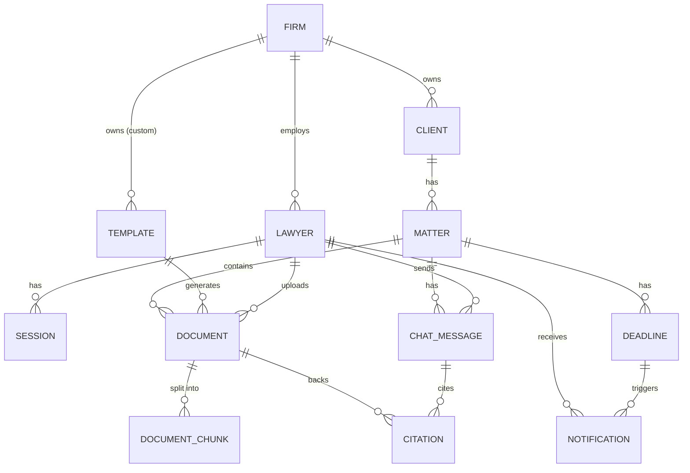

# System Architecture — Legal AI Assistant

Traces to [02-Requirements.md](02-Requirements.md). Solo/self-funded/low-budget constraint (Charter §5) drives every choice below toward fewer moving parts and lower ops burden over raw scalability — this system needs to comfortably serve NFR-006's target (≥50 concurrent Matters × 500 Documents), not thousands of tenants.

**Three services, split by explicit user requirement:** Next.js is UI-only — it owns no business logic, no database connection, and no API routes of its own; every read/write goes to one of two backends over HTTP. **Java** (Spring Boot) owns everything CRUD/"rest of the backend": auth, Firm/Client/Matter/Deadline/Notification/Template/Search. **Python** (FastAPI) owns everything AI: document ingestion (OCR → chunk → embed) and the AI Chat retrieval/generation pipeline — not yet built (Build Plan V0.3/V0.4), but the service boundary is established now. Both backends connect to the same Postgres database; its schema is owned by neither language directly — see §3.

## 1. Architecture Diagram

```mermaid
flowchart LR
    Browser["Lawyer's Browser"]

    subgraph FE["Frontend — Next.js (UI only, no DB access)"]
        UI["Pages / Components"]
    end

    subgraph JavaBE["Java Backend — Spring Boot (CRUD + auth + \"rest of the backend\")"]
        JavaAPI["REST Controllers<br/>Auth, Client, Matter, Deadline,<br/>Notification, Template, Search"]
    end

    subgraph PyBE["Python Backend — FastAPI (AI) — not yet built, V0.3/V0.4"]
        PyAPI["Document Ingestion Pipeline<br/>AI Chat / Retrieval / Generation"]
    end

    subgraph Data["Data Layer"]
        PG[("PostgreSQL + pgvector<br/>schema owned by /database (Drizzle)")]
        R2[("Object Storage<br/>Cloudflare R2 — Documents")]
        Redis[("Redis — Job Queue")]
    end

    subgraph External["External Services — still Undecided (spike)"]
        OCR["OCR Engine"]
        Embed["Embedding Model"]
        LLM["LLM Provider (chat)"]
        Mail["Email — Resend"]
    end

    Browser <-->|HTTPS/JSON| UI
    UI -->|fetch, forwarding the session cookie server-side| JavaAPI
    UI -.->|fetch, once V0.3/V0.4 exist| PyAPI

    JavaAPI -->|hash/verify password, issue/verify session| PG
    JavaAPI -->|CRUD: Firm/Client/Matter/Deadline/Notification/Template| PG
    JavaAPI -->|upload/download| R2
    JavaAPI -.->|enqueue ingestion job, once V0.3 exists| Redis
    JavaAPI -->|send reminder| Mail

    Redis -.-> PyAPI
    PyAPI -.->|fetch file| R2
    PyAPI -.->|extract text| OCR
    PyAPI -.->|generate vectors| Embed
    PyAPI -.->|retrieve chunks, generate grounded answer| LLM
    PyAPI -.->|store chunks/embeddings, ChatMessage, Citation| PG
```

Dotted edges are not built yet (Build Plan V0.3 onward) — shown to establish the intended service boundary early, per the user's explicit split, not because they exist today.

**Read path (Client/Matter/etc., today):** Browser → Next.js (Server Component, forwarding the session cookie, or a client-side `fetch`) → Java REST API → Postgres → back up the chain.

**Auth path (today):** Browser → Next.js → Java `/api/auth/*` → Postgres (`lawyers`/`sessions` tables) → `Set-Cookie` back to the browser (§5).

**Chat query path (built V0.4):** Browser → Next.js → **Java** (auth + BR-008 Matter-ownership check, same as every other endpoint) → Python (hybrid retrieval over `document_chunks` → LLM grounded answer → persists `ChatMessage`/`Citation`) → back up the chain, Java relaying Python's response unchanged. The diagram's dotted "Browser → Python API" edge above was shorthand for *which service owns the chat domain*, not a literal call graph — SD-003's "Java is the sole authority on session validity" (§2) rules out the browser calling Python directly without duplicating session verification into a second language. Java's own `POST /chat/:matterId` call to Python is synchronous (unlike V0.3's fire-and-forget ingestion hand-off), since the browser is waiting on an answer.

**Future write path (document upload, V0.3):** Browser → Next.js → Java (stores file in R2, creates the `Document` row) → enqueues a job → Python picks it up → OCR/chunk/embed → writes `DocumentChunk` rows → Java's `Document.status` becomes `'ready'` (exact hand-off mechanism TBD when V0.3 is actually built).

## 2. Modules / Components

| ID | Module | Service | Responsibility | Does NOT do |
|---|---|---|---|---|
| SD-001 | Web/UI Layer | Next.js (frontend) | Renders all 16 screens (UX doc §1); calls the Java API (and, from V0.3/V0.4, the Python API); owns client-side empty/error/loading states. | No direct DB or storage access — not even for Server Components; everything goes through an HTTP call to a backend. |
| SD-002 | API Layer | Java (Spring Boot) | REST endpoints for every CRUD entity; validates input; enforces Firm-level data isolation (BR-008) on every query. | No business-rule decisions belong here beyond request validation — those live in the module that owns the entity. Not the home for AI-specific endpoints (SD-004/SD-005 below). |
| SD-003 | Auth Module | Java (Spring Boot) | Owns password hashing (`BCryptPasswordEncoder`, cost 12) and session issuance/verification end to end: register/login create a `Session` row and set an httpOnly cookie; every request resolves that cookie to a `Lawyer` row and `firm_id`; logout deletes the `Session` row. | Does not delegate credential storage or session validity to any third party — this module is the sole authority on both. |
| SD-004 | Document Ingestion Pipeline | Python (FastAPI) | Triggered by a direct HTTP call from Java right after upload (§6); fetches the file from storage, extracts text (native PDF/DOCX) or OCRs it (EasyOCR, image-based content), splits it into chunks, generates embeddings (`all-MiniLM-L6-v2`), writes `DocumentChunk` rows, updates `Document.status` (REQ-004, NFR-002). | Does not own the `Document` row's initial creation or the upload endpoint itself — that's Java (SD-002), since the upload/CRUD shell around a Document is "rest of the backend," not AI. Not queue-based as of V0.3 (§7). |
| SD-005 | AI Chat Module | Python (FastAPI), fronted by Java's auth/BR-008 gate — **built V0.4** | Retrieves relevant `DocumentChunk`s for a Matter only (BR-005), builds a grounded prompt, calls the LLM, verifies citations against `Citation` rows, persists the `ChatMessage`. Returns "not found" rather than fabricating when retrieval has no relevant chunks (REQ-007, BR-006). Exposed only internally (`/chat/:matterId`, called by Java) — never directly by the browser. | Does not ingest documents (SD-004), answer questions using another Matter's chunks, or independently verify sessions (that's SD-003/Java's job). |
| SD-006 | Deadline & Notification Module | Java (Spring Boot) — not yet built, V0.5 | CRUD on `Deadline`; the scheduled scanner that creates `Notification` rows and triggers email; enforces BR-003 (blocks `Matter.close` while open Deadlines exist, returning the specific blocking Deadlines). | Does not send arbitrary/marketing email — only Deadline reminders. |
| SD-007 | Template / Draft Generation Module | Java (Spring Boot) — not yet built, V0.8 | Renders a `Template` with a Matter/Client's data into a new `Document` (`is_draft=true`), then hands it to SD-004 like any other upload so it becomes queryable (REQ-015, REQ-020). | Does not create templates from user free text — templates are pre-authored. Template *rendering* is CRUD-adjacent (Java); it's SD-004 (Python) that makes the resulting Document queryable. |
| SD-008 | Storage Module | Java (Spring Boot) | `StorageService` interface; `LocalFilesystemStorageService` in dev (no R2 credentials available, §6), stores under a local directory keyed by UUID. A future `R2StorageService` implements the same interface for production. | Not a document viewer/renderer. |
| SD-009 | Search Module | Java (Spring Boot) — not yet built, V0.6 | Cross-entity search over `Client`/`Matter` (REQ-011) using Postgres full-text search — no separate search engine at this scale. | Does not search inside Document content — that's the Chat Module's job (BR-005 keeps it Matter-scoped rather than a free-text document search). |

**Shared database, two backend languages.** Both Java and Python connect to the same Postgres instance and schema. The schema itself is owned by neither language's ORM — see §3 — specifically so a change doesn't require coordinating two different migration tools. Each service only reads/writes the tables its modules above own (Java: `firms`/`lawyers`/`sessions`/`clients`/`matters`/`deadlines`/`notifications`/`templates`; Python, once built: `document_chunks`/`chat_messages`/`citations`, plus updating `documents.status`). This is a real coupling point accepted as the cost of the user's explicit language split — a schema change touching both sides' entities needs both codebases updated together.

## 3. Database Schema

PostgreSQL 16, one schema, `pgvector` extension enabled. Every tenant-owned table carries `firm_id` (directly or via its parent) to make BR-008 isolation a single indexed predicate rather than a multi-join check.

**Schema ownership:** lives in `/database` at the repo root (Drizzle schema + migrations, kept purely as a CLI migration tool — no longer part of an application's dependency tree, since neither backend's runtime touches Drizzle). Java's Spring Data JPA entities map onto these tables with `ddl-auto=validate` — Hibernate never creates or alters a table, only maps onto what `/database`'s migrations already produced. Python will do the same once it exists. This keeps exactly one tool authoring schema changes regardless of how many backend languages read/write the data.



| Entity | Field | Type | Notes |
|---|---|---|---|
| **Firm** | id | uuid PK | |
| | name | text | |
| | created_at | timestamptz | |
| **Lawyer** | id | uuid PK | self-generated |
| | firm_id | uuid FK → Firm | |
| | name | text | |
| | email | text, unique | |
| | password_hash | text | bcrypt, cost 12 — never returned by any API response |
| | role | enum('owner','member') | owner can't be removed (SCR-15) |
| | created_at | timestamptz | |
| **Session** | id | uuid PK | |
| | lawyer_id | uuid FK → Lawyer | |
| | token_hash | text, unique | SHA-256 of the opaque token stored in the cookie — the raw token is never persisted |
| | expires_at | timestamptz | fixed 7-day expiry from creation |
| | created_at | timestamptz | |
| **Client** | id | uuid PK | |
| | firm_id | uuid FK → Firm | BR-008 |
| | name | text | required |
| | contact_email | text, nullable | |
| | contact_phone | text, nullable | |
| | notes | text, nullable | |
| | created_at / updated_at | timestamptz | |
| **Matter** | id | uuid PK | |
| | firm_id | uuid FK → Firm | BR-008 |
| | client_id | uuid FK → Client | BR-001 |
| | title | text | required |
| | status | enum('open','closed') | BR-003 |
| | closed_at | timestamptz, nullable | |
| | created_at / updated_at | timestamptz | |
| **Document** | id | uuid PK | |
| | matter_id | uuid FK → Matter | BR-002 |
| | uploaded_by | uuid FK → Lawyer | |
| | file_name | text | |
| | storage_key | text | R2 object key |
| | mime_type | text | |
| | size_bytes | bigint | |
| | status | enum('uploading','processing','ready','failed') | REQ-004 |
| | is_draft | boolean, default false | REQ-020 |
| | source_template_id | uuid FK → Template, nullable | REQ-015 |
| | error_message | text, nullable | shown on SCR-09 retry state |
| | created_at | timestamptz | |
| **DocumentChunk** | id | uuid PK | |
| | document_id | uuid FK → Document, `ON DELETE CASCADE` | deleting a Document (REQ-027) automatically removes its chunks at the DB level — Java never manipulates `document_chunks` directly, preserving the Java/Python ownership boundary (§2) |
| | page_number | int, nullable | for citations (REQ-006) |
| | content | text | extracted chunk text |
| | embedding | vector(384) | dimension fixed by `all-MiniLM-L6-v2` (§6) |
| | created_at | timestamptz | |
| **Deadline** | id | uuid PK | |
| | matter_id | uuid FK → Matter | BR-004 |
| | title | text | required |
| | due_date | date | required |
| | status | enum('open','complete') | BR-003 |
| | notification_lead_days | int, default 3 | REQ-016 |
| | created_at / updated_at | timestamptz | |
| **Notification** | id | uuid PK | |
| | lawyer_id | uuid FK → Lawyer | recipient |
| | deadline_id | uuid FK → Deadline | |
| | message | text | |
| | sent_at | timestamptz, nullable | |
| | read_at | timestamptz, nullable | |
| | created_at | timestamptz | |
| **ChatMessage** | id | uuid PK | |
| | matter_id | uuid FK → Matter | BR-005 |
| | lawyer_id | uuid FK → Lawyer, nullable | null when role='assistant' |
| | role | enum('user','assistant') | |
| | content | text | |
| | created_at | timestamptz | |
| **Citation** | id | uuid PK | |
| | chat_message_id | uuid FK → ChatMessage, `ON DELETE CASCADE` | a Citation can't outlive its ChatMessage |
| | document_id | uuid FK → Document, nullable, `ON DELETE SET NULL` | REQ-027 lets a Document be deleted unconditionally; a Citation survives that as the historical record (AI Architecture §4, "persisted permanently") rather than being deleted or blocking the Document delete |
| | page_number | int, nullable | |
| | excerpt | text, nullable | quoted snippet backing the claim (BR-006) |
| | created_at | timestamptz | |
| **Template** | id | uuid PK | |
| | firm_id | uuid FK → Firm, nullable | null = system template, set = firm-custom |
| | name | text | |
| | description | text, nullable | |
| | body | text | placeholder-bearing template content |
| | created_at | timestamptz | |

## 4. API Design

Served by the **Java backend** (`http://localhost:8080` in dev; Next.js has no API routes of its own). All routes under `/api`, JSON in/out, all require an authenticated session (§5) except `/api/auth/register` and `/api/auth/login`. Every list/detail route implicitly filters by the caller's `firm_id` (BR-008); a record outside the caller's Firm returns 404, never 403, to avoid confirming its existence. CORS is configured to allow the Next.js origin specifically, with credentials enabled, since the frontend now calls this API cross-origin rather than through same-origin Next.js API routes.

The contract below (paths, request/response shapes, status codes) is unchanged from before the Java migration — "no functionality should change" means the frontend's calls needed no reshaping, only a different base URL and explicit credential forwarding — with one addition: `GET /api/auth/me`. It didn't exist before because Server Components could call `getCurrentLawyer()` directly, in-process; once the frontend has no DB access, knowing "who am I" for page rendering requires a real network round-trip. Same data as always (a lawyer's own identity), new access path — not new functionality.

| Method | Path | Request | Response | Status codes |
|---|---|---|---|---|
| POST | `/api/auth/register` | `{ name, email, password }` | `{ lawyer: Lawyer }` (sets session cookie); creates a new `Firm` + `Lawyer` (`role='owner'`) | 201, 400, 409 |
| POST | `/api/auth/login` | `{ email, password }` | `{ lawyer: Lawyer }` (sets session cookie) | 200, 400, 401 |
| GET | `/api/auth/me` | — | `{ lawyer: Lawyer }` | 200, 401 |
| POST | `/api/auth/logout` | — | `{}` (clears session cookie, deletes `Session` row) | 200 |
| GET | `/api/firm/members` | — | `{ members: Lawyer[] }` | 200 |
| POST | `/api/firm/invite` | `{ email }` | `{ invitationId }` | 201, 400, 403 |
| DELETE | `/api/firm/members/:id` | — | — | 204, 403, 404 |
| GET | `/api/clients` | query params `q`, `status` | `{ clients: Client[] }` | 200 |
| POST | `/api/clients` | `{ name, contact_email?, contact_phone?, notes? }` | `Client` | 201, 400 |
| GET | `/api/clients/:id` | — | `{ client: Client, matters: Matter[] }` | 200, 404 |
| PATCH | `/api/clients/:id` | partial `Client` fields | `Client` | 200, 400, 404 |
| GET | `/api/matters` | query params `q`, `status`, `clientId` | `{ matters: Matter[] }` | 200 |
| POST | `/api/matters` | `{ client_id, title }` | `Matter` | 201, 400, 404 |
| GET | `/api/matters/:id` | — | `{ matter: Matter, client: Client }` | 200, 404 |
| PATCH | `/api/matters/:id` | `{ title? }` | `Matter` | 200, 400, 404 |
| POST | `/api/matters/:id/close` | — | `Matter` or `{ error: { code:'OPEN_DEADLINES', openDeadlines: Deadline[] } }` | 200, 404, 409 |
| GET | `/api/matters/:id/documents` | — | `{ documents: Document[] }` | 200, 404 |
| POST | `/api/matters/:id/documents` | multipart file(s) | `{ documents: Document[] }` (status="processing") | 201, 400, 404 |
| GET | `/api/documents/:id` | — | `Document` | 200, 404 |
| GET | `/api/documents/:id/download` | — | Raw file bytes (`Content-Disposition: attachment`), not a presigned URL — local filesystem storage in dev streams directly rather than redirecting (§6); a future `R2StorageService` may switch this to a presigned-URL redirect. | 200, 404 |
| DELETE | `/api/documents/:id` | — | — (REQ-027; unrestricted — not gated on Matter status, per explicit user decision) | 204, 404 |
| GET | `/api/matters/:id/chat` | — | `{ messages: ChatMessage[] & { citations: Citation[] } }` — Java verifies auth + Matter ownership, then synchronously proxies to Python's internal `GET /chat/:matterId` (not browser-facing, same trust boundary as `/ingest/:documentId`) | 200, 404 |
| POST | `/api/matters/:id/chat` | `{ question }` | `ChatMessage & { citations: Citation[], lowConfidence: boolean }` — same Java-verifies-then-proxies-to-Python pattern, but blocking rather than fire-and-forget since the browser is waiting on the answer | 200, 404, 422, 502 |
| GET | `/api/matters/:id/deadlines` | — | `{ deadlines: Deadline[] }` | 200, 404 |
| POST | `/api/matters/:id/deadlines` | `{ title, due_date, notification_lead_days? }` | `Deadline` | 201, 400, 404 |
| PATCH | `/api/deadlines/:id` | `{ title?, due_date?, status?, notification_lead_days? }` | `Deadline` | 200, 400, 404 |
| GET | `/api/deadlines/upcoming` | query param `days` (default 14) | `{ deadlines: (Deadline & { matter: Matter })[] }` | 200 |
| GET | `/api/notifications` | — | `{ notifications: Notification[] }` | 200 |
| PATCH | `/api/notifications/:id/read` | — | `Notification` | 200, 404 |
| GET | `/api/templates` | — | `{ templates: Template[] }` | 200 |
| POST | `/api/matters/:id/documents/generate` | `{ template_id, fields }` | `Document` (status="processing") | 201, 400, 404, 502 |
| GET | `/api/search` | query param `q` | `{ clients: Client[], matters: Matter[] }` | 200 |

`422` on chat = the Matter has no `Document` with `status='ready'` yet (nothing to ground an answer in). `502` on chat/generate = the LLM/template-render call failed — the API never substitutes a guess for a failed call (REQ-007).

## 5. Auth Flow

Self-hosted: password hashing and session issuance/verification are owned entirely by SD-003 (§2), now implemented in Java — no third-party auth provider. Two sub-flows: register/login (issues a session) and every subsequent request (verifies one). Cookie scoping (domain-based, not port-based) means a cookie the Java backend sets for `localhost` is also sent by the browser to the Next.js origin on a different port — no special cross-port cookie configuration needed for local dev, only correct CORS + `credentials: 'include'` on client-side fetches, and explicit cookie-forwarding on server-side ones (step 5a below).

```mermaid
sequenceDiagram
    participant B as Browser
    participant N as Next.js (SD-001)
    participant A as Java API (SD-002/SD-003)
    participant D as Postgres

    Note over B,D: Register or Log in (client-side fetch, credentials: include)
    B->>A: 1. POST /api/auth/register or /login
    A->>D: 2. register: hash password (BCrypt) + create Firm+Lawyer<br/>login: fetch Lawyer by email, BCrypt verify
    A->>D: 3. Create Session row (token_hash, expires_at = now + 7d)
    A-->>B: 4. Set-Cookie: session=<opaque token> (httpOnly, sameSite=lax, secure in prod)

    Note over B,D: Every subsequent request
    alt Server Component page load
        B->>N: 5a. Page request (browser cookie attached, same "localhost" domain)
        N->>A: 5b. fetch, manually forwarding the Cookie header
    else Client-side form/action
        B->>A: 5c. fetch directly, credentials: include
    end
    A->>A: 6. SHA-256 the cookie token
    A->>D: 7. Look up Session by token_hash; join Lawyer
    D-->>A: 8. Lawyer row (firm_id, role) — or nothing if expired/absent
    A->>D: 9. Execute query, always scoped by firm_id (BR-008)
    A-->>B: 10. Response (or 401 if step 8 finds nothing → redirect to login)
```

1–2. Register hashes the submitted password with BCrypt (cost 12, cross-verified compatible with the pre-existing Node-generated hashes via a real spike — Technology Decision Log) and creates a new `Firm` + `Lawyer` (`role='owner'`) in one transaction. Login instead fetches the `Lawyer` by email and verifies against the stored `password_hash`; a mismatch returns 401 without revealing whether the email existed.
3–4. A cryptographically random 256-bit token is generated; only its SHA-256 hash is stored in `Session.token_hash` — the raw token exists solely in the browser's cookie, so a database leak alone can't be replayed as a valid session. The cookie is httpOnly (no JS access), `sameSite=lax`, `secure` outside local dev, 7-day expiry matching `Session.expires_at`.
5. Two paths depending on where the request originates: a Server Component rendering a page must explicitly read the incoming cookie (Next.js `cookies()`) and attach it as a `Cookie` header on its own server-to-server call to Java (5a→5b) — unlike same-origin API routes, this forwarding doesn't happen automatically across services. A client-side form submits directly to Java with `credentials: 'include'` (5c).
6–8. Every request hashes the incoming cookie token the same way and looks up the matching `Session`; an expired or missing session resolves to "no Lawyer," short-circuiting to 401. This lookup is real per-request DB verification, not a signature check on a self-contained token — a session can be revoked by deleting its row (used by logout).
9. `firm_id` from the resolved `Lawyer` is threaded through every subsequent query in that request via the same shared data-access helper as before — BR-008 enforcement didn't change when the auth backend did.
10. Normal response, or 401 → browser redirects to the login screen.

Next.js middleware (`middleware.ts`) still does a cheap cookie-presence check for fast redirects on protected routes; the real authorization boundary is step 6–8 above, run on every Java request via an explicitly-called current-lawyer resolver — matches the CLAUDE.md gotcha that a route missing from the middleware matcher must still not be reachable unauthenticated (now doubly true: it also isn't reachable without Java independently validating the session).

## 6. Technology Stack

| Capability | Technology + Version | Reason |
|---|---|---|
| Frontend (UI only) | Next.js 15 (App Router), React 19, TypeScript 5 | No longer serves an API of its own — Server Components and client forms both call the Java (and eventually Python) backend over HTTP. TypeScript still catches shape mismatches before a lawyer-facing screen. |
| **Backend — CRUD/"rest of the backend"** | **Java 21 (LTS) + Spring Boot 4.1**, built with **Maven** via the Maven Wrapper (`mvnw`) | Explicit user requirement to split the backend by language: Java owns auth, Firm/Client/Matter/Deadline/Notification/Template/Search — everything that isn't AI. Maven Wrapper chosen over a system-wide Maven install specifically because this machine has no admin rights to install one; `mvnw` self-bootstraps per-project with no elevation needed. |
| Backend (CRUD) — persistence | Spring Data JPA + Hibernate 7 | Standard, idiomatic pairing with Spring Boot; maps directly onto the `/database`-owned schema with `ddl-auto=validate` (§3) rather than generating its own. |
| Backend (CRUD) — password hashing | `spring-security-crypto`'s `BCryptPasswordEncoder` (cost 12) | Cross-verified compatible with the existing Node-`bcrypt`-generated hashes via a real spike against live data — no forced password reset for the (test) users created before this migration. Deliberately just the crypto module, not the full `spring-boot-starter-security` — this project hand-rolls session/cookie auth rather than using Spring Security's session framework. |
| **Backend — AI** | **Python 3.13 + FastAPI** — scaffolded only (health check); no AI functionality exists yet to migrate | Explicit user requirement: Python's OCR/embedding/LLM tooling ecosystem is the reason for this split at all — it's meaningfully stronger than either Node's or Java's for this specific slice (Build Plan V0.3/V0.4). |
| Database | PostgreSQL 16 + `pgvector` | Unchanged — one database for relational data *and* future embeddings, shared by both backends (§2). Verify the chosen host supports `pgvector` before provisioning. |
| Schema / migrations | Drizzle Kit (TypeScript), living in `/database`, decoupled from any application | Kept as the single schema-authoring tool across two backend languages (§3) rather than introducing a second migration tool (e.g., Flyway) that only one side would use — fewer moving parts, per Charter §5. |
| Background jobs | BullMQ + Redis (`ioredis`) — not yet built, needed from V0.3 | Durable retryable queue for ingestion (up to 60s, NFR-002) and the deadline scanner. Which service(s) own which queue is finalized when V0.3/V0.5 are actually built. |
| Object storage | Cloudflare R2 in production; **local filesystem in dev** (`backend-java`'s `StorageService` interface, `LocalFilesystemStorageService` implementation) | No R2 account/credentials available to this environment (same access constraint as the earlier Clerk decision). Kept behind the same interface a real `R2StorageService` will implement later, so swapping in real credentials is a contained change, not a rewrite. |
| OCR engine | **EasyOCR 1.7.2** (Python, PyTorch-based) | **Spiked for real**: no system Tesseract binary available and no admin rights to install one (`choco install` fails the same way Maven's did — CLAUDE.md §4). EasyOCR needs no system binary, installs via pip alone. A synthetic test image ("Invoice Number 48213") was correctly OCR'd — 1.4s per image after a one-time ~30s model download (cached to disk after first run). Shares its PyTorch dependency with the embedding model below, so the two together cost one CPU-only `torch` install, not two. |
| Embedding model | **`sentence-transformers` 5.7.0, model `all-MiniLM-L6-v2`** (384 dimensions) | **Spiked for real**: runs fully locally, no API key, no per-call cost — fits the low-budget constraint better than a paid embeddings API. Real chunks embedded in ~53ms each after a ~6.5s one-time model load; fixes `document_chunks.embedding` at `vector(384)` (§3). Retrieval-quality validation against BR-006's citation-accuracy bar is deferred to V0.4, when there's an actual LLM in the loop to validate against — this spike only proves the model runs correctly and produces well-formed vectors. |
| Backend (AI) — text extraction | `pypdf` 6.16.1 (PDF), `python-docx` 1.2.0 (DOCX) | Pure-Python, no native/system dependency, standard choices for native (non-scanned) document text extraction — the common case; OCR is the fallback only for image-based content. |
| Backend (AI) — DB access | SQLAlchemy 2.0.52 + `psycopg2-binary` | Python's equivalent of Java's Spring Data JPA for this project: maps onto `/database`'s existing schema (no migrations owned by SQLAlchemy), mirroring Java's `ddl-auto=validate` posture. |
| Java ↔ Python hand-off (V0.3) | Direct HTTP call, Java → Python's `POST /ingest/{documentId}`, fired without blocking Java's own response to the browser | Explicit scope decision: BullMQ/Redis (durable retry queue) is deferred until it's actually justified by a real reliability need — for V0.3, Java marks a Document `'failed'` itself if the call can't even reach Python (connection error), and Python marks it `'failed'` with `error_message` for any in-process failure (bad file, extraction error) — every failure still ends in a visible state (System Architecture §7's "no failure is invisible" rule), just without automatic retries yet. |
| Java ↔ Python hand-off (V0.4, chat) | Direct HTTP call, Java → Python's `POST /chat/{matterId}` / `GET /chat/{matterId}` — **blocking**, unlike V0.3's fire-and-forget | The browser is waiting on an answer, not just an upload acknowledgement — Java's `HttpChatGateway` sends and waits (30s timeout for `ask`, generous relative to NFR-001's 8s p95 target to absorb the one-retry corrective-regeneration path), then relays Python's status code and body back unchanged. A `422` from Python (no ready Documents) or `5xx` (retrieval/LLM failure) is translated into `NoReadyDocumentsException`/`AssistantUnavailableException` and mapped back to the same codes for the browser — Java never substitutes its own guess for what Python returned. |
| Email | Resend | Simple transactional email API; free tier covers MVP-scale Deadline reminders (REQ-009). |
| Hosting | Railway (web service + Java service + Python service + managed Postgres + Redis add-ons, once all exist) | Supports always-on processes in any language (unlike pure-serverless hosts); usage-based pricing fits low, unpredictable MVP load. |
| LLM provider (chat) | **OpenAI `gpt-4o-mini`**, via the `openai` Python SDK, temperature 0 | Explicit user decision (asked directly rather than defaulted, given this is a paid external API on a legal-data product) — **spiked for real** before any pipeline code was built around it: a live call with a two-chunk grounded prompt produced correctly `[1]`/`[2]`-cited output and correctly refused to answer a question the context didn't cover (Technology Decision Log, Build Plan V0.4). |

**Note — REQ-014 (Firm invites, Build Plan V0.7):** already didn't inherit Clerk's Organizations feature once auth went self-hosted; unaffected further by the Java/Python split. Still needs its own token-based invite mechanism when V0.7 is built, now in Java.

## 7. Cross-Cutting Concerns

**Caching.** Minimal by design — at NFR-006's scale, Postgres alone is fast enough for almost everything. Two narrow exceptions, both in Java once built: the Dashboard's Upcoming-Deadlines widget (SCR-03) gets a 60s per-Firm cache since it's read far more often than Deadlines change; the Template list (SCR-12) is cached until the next template write. AI Assistant answers are **never** cached — a newly uploaded or reprocessed Document could change the correct answer, and a stale cached answer would silently violate BR-006.

**Background jobs.** `notification-scan` (SD-006, Java, not yet built): a repeating job (hourly) that finds Deadlines where `due_date - notification_lead_days` is today, and is idempotent — it checks for an existing `Notification` on that Deadline for the day before creating another, so a worker restart can't double-send. `document-ingestion` (SD-004, Python) is **not a queue as of V0.3** — it's a direct HTTP call from Java, processed synchronously by Python (§6's "Java ↔ Python hand-off" row); no automatic retry on failure yet, an explicit scope decision, not an oversight. Every failure still ends in a visible `Document.status='failed'` with `error_message`, never a silent drop — surfaced via SCR-09/SCR-10's retry state — but re-attempting currently requires the lawyer to re-upload, not an automatic background retry. Revisit with a real queue (BullMQ+Redis) if failure rates in practice justify the added infrastructure.

**Error handling.** API errors return one consistent shape — `{ error: { code, message, ...details } }` — with 4xx reserved for client-correctable problems (validation, not-found, BR-003's close-conflict) and 5xx only for genuine system faults. This shape is enforced identically regardless of which backend answers the request — Java today, Python from V0.3 — so the frontend never needs to branch error-handling logic by service. The AI Chat Module (Python, once built) never returns a fabricated answer on failure: an LLM-call error surfaces as 502, rendered by SCR-09 as "Couldn't reach the Assistant — retry," never retried into a guess. Background-job failures are logged with `matter_id`/`document_id` context and always end in a visible state (`failed`, never a silent drop) — no failure is invisible to the lawyer, per the reliability principle behind Charter Goal 3. Logging is structured with a request id for correlation (Java: standard SLF4J/Logback; Python: standard `logging`); document/chat content is never written to logs (NFR-005/NFR-008).
