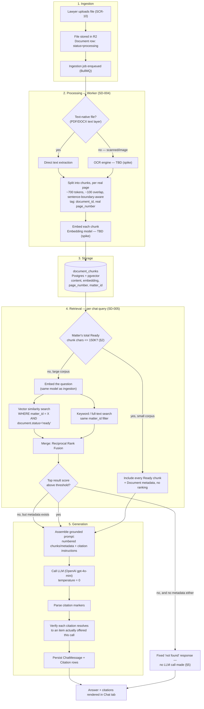

# AI Architecture — AI Assistant Feature

Elaborates on SD-004 (Document Ingestion Pipeline) and SD-005 (AI Chat Module) from [05-System-Architecture.md](05-System-Architecture.md). OCR engine, embedding model, and LLM provider were originally **Undecided — needs a spike** (per that doc's Technology Stack) — all three are now resolved by real spikes: EasyOCR + `all-MiniLM-L6-v2` (V0.3), OpenAI `gpt-4o-mini` (V0.4). Numbers below (chunk size, thresholds, top-K) are still provisional starting points, not final-tuned values, but the mechanisms around them (chunking algorithm, retrieval thresholds) are real and live, not placeholders.

## 1. Pipeline Diagram

The branch at D5 is the load-bearing part of this diagram for **large** Matters: when nothing scores above the relevance threshold and no metadata can answer either, the pipeline never reaches the LLM at all — a structural guarantee against hallucination for the zero-context case (§3, Rule 3), not a prompt-level instruction the model could ignore. For **small** Matters (D0's common case in practice — see §2), that structural guarantee doesn't apply the same way: the LLM always gets called with the entire corpus, and whether a question is answerable is left to its own judgment plus post-generation citation verification (§3, Rules 4/5) — a deliberate, real tradeoff made 2026-08-16 after ranked top-8 selection proved unable to answer broad questions at all (see §2).

## 2. Retrieval / Ranking Strategy

**Decided:**
- **Hybrid retrieval.** Two parallel lookups against `document_chunks`, both hard-filtered to `matter_id = <current Matter>` and `document.status = 'ready'` (BR-005): (a) vector similarity via `pgvector` cosine distance on the embedded question, top 20 candidates; (b) Postgres full-text keyword search on chunk content, top 20 candidates. Reason: legal text leans on exact terms — party names, statute/section numbers, case citations — that pure semantic similarity can miss or blur; keyword search catches those, vector search catches paraphrase/conceptual matches.
- **Fusion.** Results merged with Reciprocal Rank Fusion (RRF) rather than picking one method — avoids needing to hand-tune a blend weight between two different score scales.
- **Full context for small Matters, ranked top-8 only once a Matter outgrows that (rebuilt 2026-08-16 — real bug, see below).** Below `FULL_CONTEXT_CHAR_CAP = 150,000` characters (~37K tokens) of total Ready-chunk content for the Matter, every chunk is included directly — no RRF ranking, no relevance-threshold gate. Only once a Matter's real corpus exceeds that does retrieval fall back to hybrid search + RRF + top-8, exactly as before. Reason: ranked top-8 selection cannot answer a genuinely comprehensive question ("create a complete chronology," "identify all important dates") against a document whose relevant facts are spread across dozens of pages — see the real-bug entry below for the measured evidence. **Real, measured latency tradeoff:** several full-context calls against a real 50-chunk/60-page test document took 10–15.5s — over NFR-001's 8s p95 target. Narrow single-fact questions against the same Matter stayed fast (2–7s). This tradeoff was made deliberately, with the user's sign-off before building, in exchange for the broad-question completeness fix; it has not been further latency-optimized and should be revisited before this scales to matters much larger than what's been tested.
- **Chunking (rebuilt for real, 2026-08-15 — see §2's V0.4 addendum below).** Text is extracted and chunked *per page* — a chunk never spans two real pages — and split along sentence boundaries (paragraph breaks first where the source preserves them, sentence-boundary regex otherwise, hard word-boundary fallback only for content with no sentence punctuation at all, e.g. a table row). ~2800 characters per chunk (~700 tokens), ~400-character overlap (~100 tokens), overlap carried as whole trailing sentences rather than a raw character slice. Each chunk is tagged with `document_id` and the real `page_number` it came from (1-indexed for PDF/images; `NULL` for DOCX, which has no page concept in the file itself).
- **Conversation context.** The last 4 user/assistant turns from `ChatMessage` are included in the prompt so follow-up questions ("what about the second clause?") resolve correctly, but retrieval itself always re-runs against the *current* question, not the whole conversation — prevents drift toward stale earlier topics.
- **Reranking.** Not included in MVP. A cross-encoder rerank step could improve precision on the top-K, but picking a reranker model is itself a vendor decision with the same risk profile as the embedding-model spike — deferred until hybrid+RRF proves insufficient in practice.
- **Document metadata, alongside content (added 2026-08-15).** Real, system-computed facts about each Ready Document in the Matter — file name, real page count (`max(document_chunks.page_number)`, `NULL` for DOCX) — are always fetched and offered to the LLM as trailing numbered context items *after* the content chunks, clearly labeled "Document metadata." Reason: a document's own printed text about itself can be wrong (a fictional test PDF's every-page header claimed "of 10" pages while the file has 11 real pages) — for structural questions (page count, file name, how many documents), real system data is authoritative and the prompt says to prefer it over what a document's text claims about itself. Distinct from content chunks (which are retrieved/ranked), metadata for every Ready Document is always included — there are typically only a few documents per Matter, so this is cheap and doesn't need its own relevance ranking. When content retrieval finds nothing above the relevance floor but metadata exists, a separate metadata-only LLM call is tried (zero document content in that prompt) before falling back to the fixed not-found response — a purely structural question ("how many documents are in this Matter") might not match any content chunk at all, but shouldn't be refused if metadata can answer it.

**Decided (Build Plan V0.4, real spike against a real uploaded document — not chosen on paper):**
- Relevance-threshold cutoffs are set on the **RRF fused score** (§1, D6), not on raw cosine similarity — a chunk's fused score is `Σ 1/(k+rank)` across every retrieval method that surfaced it, `k=60`. `RELEVANCE_THRESHOLD = 0.01`: below this, fused retrieval found nothing worth grounding an answer in and the LLM is never called (Grounding Rule 2). `CONFIDENT_THRESHOLD = 0.02`: above the floor but below this, the LLM is still called but the answer carries a soft "based on limited matching content" indicator (§5's low-confidence row) rather than being blocked.
- The spike surfaced a real, non-rare bug rather than just validating a number: `plainto_tsquery` ANDs every significant word in the question together, so a natural-language question phrased even slightly differently from the source text (e.g. asking "how **long** is the lease term" against text that says "the term is 36 months," with no literal word "long" anywhere) matched zero rows in keyword search — even though "rent," "lease," and "term" all hit cleanly. Fixed by reusing `plainto_tsquery`'s own stemming/stopword handling but flipping its `&` to `|` (`to_tsquery('english', replace(plainto_tsquery(...)::text, ' & ', ' | '))`) so any one matching word is enough, with `ts_rank` still favoring chunks that match more words. Without this fix, hybrid retrieval silently degraded to vector-only for most real questions, undermining the reason keyword search exists at all (§2 above — catching exact terms vector search blurs).
- LLM provider: **OpenAI `gpt-4o-mini`**, temperature 0 (System Architecture §6, Technology Decision Log) — the last of AI Architecture's originally-undecided rows.

**Decided (real bug fix, 2026-08-15, found by the user's own use of the AI Assistant, not a spike):** the chunking/page-tracking mechanism described above replaces V0.3's original implementation, which had a real defect — full detail and reproduction in the Build Plan's V0.3 addendum. Summary: PDF extraction joined every page's text into one blob *before* chunking, so page boundaries were lost entirely; chunking then sliced that blob by raw character offset with no sentence/word awareness; and the DB's `page_number` column was populated with the chunk's sequential index (0, 1, 2...), not a real page number at all. A lawyer using the AI Assistant noticed citations pointing at wrong/meaningless page numbers and chunks starting mid-word, inspected `document_chunks` directly, and reported all five symptoms precisely — each one traced to one of the three root causes above. Verified against a real 11-page test PDF: every chunk now carries its real 1-indexed page number, no chunk mixes two pages' content, and every chunk starts/ends on a clean word/sentence boundary.

**Decided (second real bug fix, same day, in Grounding Rule 5's own verification pass rather than in ingestion):** the sentence-boundary regex used to check "does every sentence carry a valid citation marker" had the same class of defect as the chunking bug above, just hitting a different abbreviation — "Apex Components **Pvt.** Ltd." (a company suffix, not a paraphrase issue) was mis-split mid-name, silently detaching a real citation marker from its sentence and causing that whole sentence (plus a cascading later one) to be dropped as unsupported. Since ingestion's chunker had independently hit the near-identical bug on "Rs." during its own build, this was clearly a duplicated-logic risk, not a one-off: extracted a single shared `app/domain/sentence_split.py` (an abbreviation-aware splitter — `Pvt`, `Ltd`, `Mr`, `Dr`, `Rs`, `LLP`, month names, single initials, extend as new false-splits appear) used by both the chunker and the citation-verification pass. Live-verified against a real chat query that had actually failed this way — see Build Plan V0.4's second bug entry for the exact before/after.

**Decided (major real-bug investigation, 2026-08-16, found by the user's own extensive real-world testing against a real 50-chunk/60-page test matter, not a spike):** nine broad/comprehensive questions ("what is this matter about," "create a complete chronology," "identify all important dates," "contradictions regarding payment," "give me a complete matter assessment," etc.) all came back thin, incomplete, or wrongly refused. Root cause, confirmed by inspecting the real document directly (not just the chat outputs): the document's real substance — parties, a 9-entry correspondence chronology, key figures, an Evidence Matrix, a Contradictions table — is concentrated on ~4 of its 60 pages, but a ranked top-8 selection against a vague broad query ("create a complete chronology" has no specific keywords to match against) doesn't reliably surface even those few pages together, let alone the rest. Fixed via the full-context change above. Also fixed in the same pass:
- **Cross-section conflation (Grounding Rule 6 tightened, partially effective — flagged, not claimed fully solved).** One answer ("contradictions regarding payment") took a gap specifically stated about the *rent* ledger (a different claim) and applied it to "the claimed payments" generally — a real fact, wrongly generalized to a topic it wasn't actually about. The prompt was tightened with an explicit "never generalize a fact stated about one specific topic to a different, related topic" instruction. Re-tested afterward: the answer improved (more precise attribution, hedged language) but a milder version of the same conflation still appeared — this is a real, only-partially-mitigated LLM precision limitation, not a mechanically fixable bug, and is called out honestly rather than claimed solved.
- **Structured templates for two recognizable broad-question archetypes**, layered on top of full cited detail rather than replacing it: a matter overview ("what is this matter about") gets a leading Client / Opposing Party / Forum block; a "complete matter assessment" gets seven ordered section headers (Matter, Client, Matter Type, Current Stage, Summary, Key Issues, Strong Evidence). First attempt at the assessment template produced a real regression — a perfectly-structured, fully-correct answer with **zero citation markers anywhere**, which the (correctly-behaving) citation verification pass then collapsed entirely to the fixed not-found response, since nothing had a marker to keep. Root cause: the template instruction told the model what sections to use but didn't restate the citation requirement at that specific point in the prompt, and the model treated the clean template as a "fill in the values" exercise. Fixed by explicitly restating "every factual sentence under these headers still needs its own citation marker" right where the template is defined, not just once elsewhere in the prompt.
- **A distinct out-of-scope response, separate from the not-found response.** "What are the strongest documents for the developer?" returned the fixed not-found response even once the Assistant had the entire document — misleading, since the documents *do* address the topic (an Evidence Matrix rating evidence strength per issue). The real problem: this question asks for a strategic/adversarial judgment (weighing evidence for one side), which Requirements §4's Non-Goals already rule out ("legal strategy formulation," "legal advice or legal decisions of any kind"), not a genuine content gap. Added `OUT_OF_SCOPE_RESPONSE`, a second fixed string alongside `NOT_FOUND_RESPONSE`, with explicit prompt guidance distinguishing "topic not addressed" (not-found) from "topic addressed, but the question asks for a judgment only the lawyer can make" (out-of-scope). Re-tested after the full-context fix specifically to confirm it wasn't just a retrieval gap before adding this — it wasn't.

**Still TBD:**
- Whether OCR'd (scanned) documents can reliably carry a true `page_number` per chunk beyond the trivial single-page case — an image upload is one OCR pass = one page (`page_number = 1`), but a true multi-page *scanned PDF* (image-in-PDF-wrapper) still isn't ingested at all (V0.3's known scope boundary, Build Plan) — this only matters once that gap is closed.
- Whether `FULL_CONTEXT_CHAR_CAP`'s real, measured latency cost (10–15.5s on the test matter, over NFR-001's budget) needs active optimization, or is an acceptable tradeoff at this project's actual scale — not yet revisited since the fix shipped.

## 3. Grounding Rules

Hallucination is prevented by structure, not by asking the model nicely — each rule below is enforced in code, with the prompt instruction as a second layer, not the only layer.

1. **Matter-scoped retrieval is a SQL filter, not a prompt instruction.** Only chunks where `document_chunks.matter_id = <current Matter>` are ever fetched from the database — a different Matter's content is never in the candidate pool to begin with, so BR-005 can't be violated by the model ignoring an instruction.
2. **Closed-book refusal below threshold.** If fused retrieval returns nothing above the relevance threshold, the system returns the fixed "not found" response directly — **the LLM is never called** for this case (Pipeline §1, branch D6). No model call means no opportunity to hallucinate from parametric/general knowledge.
3. **Context-only prompting.** When the LLM is called, the system prompt states explicitly: answer using only the numbered context chunks provided; do not use outside knowledge; if the chunks don't fully answer the question, say so rather than filling the gap.
4. **Citation-required output format.** The prompt requires every factual sentence to carry a citation marker pointing at one of the numbered context chunks. Sentences without a marker are treated as unsupported in the verification pass (Rule 5) — the model isn't trusted to self-police this.
5. **Post-generation citation verification.** After generation, every citation marker in the answer is checked against the actual set of chunks retrieved for that call. A marker that doesn't resolve to a real retrieved chunk means that claim is invalid: the system either regenerates once with a corrective instruction, or strips the unverifiable sentence and replaces it with an explicit gap note — it is never left in as if it were verified.
6. **No unsupported synthesis.** The prompt instructs the model not to draw conclusions that require combining chunks in ways the text doesn't explicitly support (e.g., inferring a legal conclusion no chunk states outright) — a prompt-level constraint, reinforced by the product boundary that the Assistant never makes legal determinations (Requirements §4, Non-Goals).
   - **Real bug (2026-08-15):** broad requests ("explain this document") were being wrongly refused with the fixed not-found response, even with abundant relevant content retrieved — the model over-applied this rule to *any* multi-chunk synthesis, not just inferred conclusions. The prompt now explicitly distinguishes restating/organizing what the chunks say (always allowed, any number of chunks) from stating something no chunk explicitly says (never allowed) — see Build Plan V0.4's third bug entry.
7. **Deterministic decoding.** Generation runs at temperature ≈ 0. This is fact-retrieval behavior, not creative generation — the goal is the most probable, most literal reading of the provided context, not variety.

## 4. Citation / Provenance Requirements

Every factual claim in an AI Assistant answer must be backed by a `Citation` row (System Architecture §3) containing:

- `document_id` + the Document's file name, so the lawyer knows which uploaded file to check.
- `page_number` where determinable — required for text-native documents; best-effort for OCR'd documents until the OCR spike settles page-tracking reliability (§2).
- `excerpt` — the actual quoted source text (1–3 sentences) backing the claim, not just a location pointer. Bar for a citation: a lawyer must be able to verify it without rereading the whole document, in roughly the time it takes to read the excerpt. **Exception (added 2026-08-15):** a citation sourced from Document metadata (§2) rather than retrieved content — e.g. "apex_meridian_10_pages.pdf has 11 pages." — has no `page_number` (there's no specific page a page-count fact came from) and its `excerpt` is a real, Python-computed fact string rather than a quoted passage; still never LLM-authored, so it's provably accurate the same way a content excerpt is the actual chunk text.
- `chat_message_id` linking it to the specific answer it supports.

Rules governing citations as a set:
- An answer with multiple distinct claims from different source locations gets **multiple** `Citation` rows, each pointing at its specific source — never one blanket citation covering an entire multi-fact answer.
- An answer with no factual claim (e.g., "I couldn't find that in this Matter's documents") requires zero citations — nothing to cite, nothing to fabricate a citation for.
- Citations are persisted permanently with their `ChatMessage` and never recomputed later. If a Document is reprocessed under a different embedding model in the future, historical answers keep the citations that were true at the time they were given — the audit trail doesn't silently shift under the lawyer. This also holds against REQ-027's unrestricted Document delete: `Citation.document_id` is `ON DELETE SET NULL` (System Architecture §3), not `CASCADE` and not `RESTRICT` — deleting a cited Document neither breaks the delete nor erases the citation's excerpt/page_number, it just loses the link to a file that's genuinely gone.
- The UI (SCR-09, Chat tab) renders each citation as a clickable reference that jumps to the source Document/location — a citation that isn't clickable/traceable doesn't satisfy REQ-006.

## 5. Failure Modes

| Failure | Trigger | Behavior |
|---|---|---|
| **No relevant data found** | Matter has zero `Document`s with `status='ready'` (nothing to search yet). | API returns `422` (per System Architecture §4) before retrieval even runs; UI shows "Upload a document first" (SCR-09 empty/disabled Chat tab). |
| **No relevant data found** | Matter has ready Documents, but fused retrieval's top result scores below the relevance threshold for this specific question. | No LLM call is made (Pipeline §1, D6). API returns `200` with the fixed response "I couldn't find anything about that in this Matter's documents." — a valid, expected outcome, not an error (REQ-007, AC-007). |
| **Low-confidence retrieval** | Chunks retrieved and above the "no relevant data" floor, but below the "confident" band (exact bounds TBD, §2). | LLM is called, but the prompt instructs it to include only claims each retrieved chunk fully supports. The answer is returned normally with its citations, plus a soft UI indicator — "This answer is based on limited matching content — verify against the source documents." Not blocked, just flagged; the lawyer still gets a cited answer to evaluate. |
| **Retrieval error** | The vector/keyword search query itself fails (DB connection error, timeout). | Treated as a system fault, not a content gap — distinct messaging from "no relevant data" so the lawyer doesn't mistake an outage for "the answer genuinely isn't in my files." API returns `502`; UI shows "Couldn't reach the Assistant — retry" (SCR-09 error state, System Architecture §7). No partial or fallback answer is attempted. Logged with `matter_id` context, no document content in the log. |
| **Generation (LLM call) error** | Retrieval succeeded, but the LLM API call itself times out or errors. | Same `502` / "Couldn't reach the Assistant — retry" pattern as a retrieval error — the two are indistinguishable to the lawyer by design, since either way the honest answer is "the system failed, not that nothing was found." Never silently retried into a lower-quality guess; a retry is a fresh, identical attempt or nothing. |
| **Out of scope (added 2026-08-16)** | The question asks for a legal-strategy or adversarial judgment (e.g. "what are the strongest documents for the developer," "should we settle") — the documents may address the topic extensively, but answering requires the kind of judgment Requirements §4's Non-Goals rule out, not organizing/restating content. | API returns `200` with the fixed `OUT_OF_SCOPE_RESPONSE` string, zero citations — distinct from the not-found response so the lawyer isn't told "not found" when the real answer is "not something I can judge." Confirmed via real testing that this is a genuine scope boundary, not a retrieval gap that the full-context fix (above) would also have solved. |
