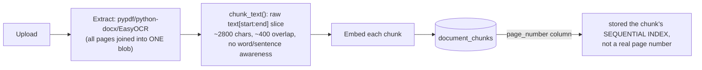
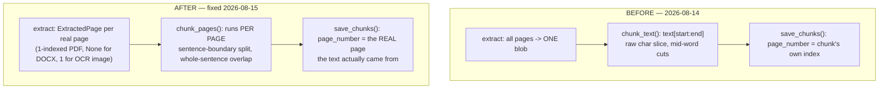
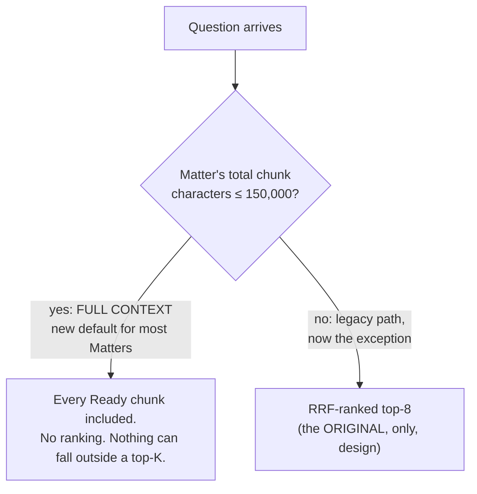

# RAG Pipeline — Development History & Lessons Learned

A study document, not a spec. Traces the AI Chat / Document Ingestion component (`backend-python`) from its first build through every real bug and architecture change since, in chronological order. Everything here is reconstructed from [08-Technology-Decision-Log.md](08-Technology-Decision-Log.md) and [07-Build-Plan.md](07-Build-Plan.md) — the project's own living build history — cross-checked against the current code. Current as of **2026-08-25** (Phase 5 below). From this date on, this document is updated live as part of finishing any RAG-pipeline work — not reconstructed after the fact the way Phases 0-4 were.

**How to read this:** each phase says what existed before, what broke or fell short, what changed, and how it was verified. Real symptom strings, real file names, and real numbers are quoted directly from the project's own record — nothing here is a generic RAG-theory recap.

---

## Phase 0 — First build (2026-08-14): a naive but working pipeline

**Ingestion (V0.3):** `pypdf`/`python-docx` extract native text; EasyOCR handles image uploads. Chunking was a single, format-blind pass: join a document's text and slice it into **~2800-character chunks with ~400-character overlap** — an approximation of AI Architecture §2's token-based sizing, not derived from a real tokenizer. Each chunk got embedded (`all-MiniLM-L6-v2`, 384-dim, spiked and resolved this same day) and written to `document_chunks`.

**Retrieval (V0.4):** hybrid search from day one — Postgres `pgvector` cosine similarity + `to_tsvector`/`plainto_tsquery` full-text search, merged with Reciprocal Rank Fusion (`k=60`). A relevance-threshold gate (spiked same day: `RELEVANCE_THRESHOLD=0.01`, `CONFIDENT_THRESHOLD=0.02`) decided whether to call the LLM (`gpt-4o-mini`, temp 0, chosen by asking the user directly) at all. Citation verification and `NOT_FOUND_RESPONSE` existed from the start — grounding was a first-class concern, not bolted on later.



**What was already solid:** the grounding discipline (citation verification, fixed refusal string, hybrid retrieval, threshold gating) — none of that needed rebuilding later. **What was fragile:** everything about chunk boundaries and page attribution, because extraction destroyed page structure before chunking ever saw it. That fragility is exactly what broke first.

---

## Phase 1 — Real usage finds real bugs (2026-08-15)

Every bug in this phase was found by the user actually using the feature (uploading real documents, asking real questions, or reading `document_chunks` directly in pgAdmin) — none were caught by a spike or a test written in advance.

### 1.1 Keyword search silently matched nothing for natural phrasing

**Symptom:** asking *"how **long** is the lease term"* against a chunk that literally says *"the term is 36 months"* matched **zero** rows via keyword search — no shared word at all, even though "rent," "lease," and "term" all appear.

**Root cause:** `plainto_tsquery` ANDs every significant word together. A natural-language question with even one word absent from the source text zeroes out keyword search's entire contribution to fusion — not a rare phrasing collision, close to the default case for real questions.

**Fix:** reuse `plainto_tsquery`'s own stemming/stopword output but flip its `&` to `|`:
```sql
to_tsquery('english', replace(plainto_tsquery('english', :query)::text, ' & ', ' | '))
```
Verified in `psql` before/after, then end to end — `lowConfidence` flipped `true → false` on an identical question once keyword search started contributing again.

### 1.2 The chunking pipeline was fundamentally broken — page numbers were never real page numbers

This is the single most important bug in this project's RAG history. The user opened `document_chunks` in pgAdmin and reported five concrete symptoms:

- `page_number` started at **0**
- chunk 0 contained real text from pages 1–3 mixed together
- chunks broke **mid-word** with no discernible pattern (example quoted directly: *"starts from `ues Clauses 7.2`..."*)
- there was no visible rule for where a chunk ended
- `page_number` topped out at **6**, unrelated to the document's real page count

**Root cause, traced to three exact lines:**
1. `_extract_pdf` joined every page's text into **one string** before chunking — page boundaries destroyed at that line.
2. `chunk_text()` sliced that blob by **raw character offset** — zero word/sentence awareness.
3. `save_chunks` stored the chunk's **sequential index** into the `page_number` column — the column never held a real page number at all; it meant "which chunk was this."



**Fix:** rebuilt `app/domain/chunk.py` around `ExtractedPage` + `chunk_pages()` — extraction now returns text **per real page**; chunking runs per page (a chunk can never span two real pages) and splits along sentence boundaries (paragraph breaks where the source has them, sentence-boundary regex otherwise, word-boundary hard-split only as a last resort for punctuation-free content like a table row); overlap is carried as whole trailing sentences, never a raw character slice.

**Verified against a real document, not a synthetic one:** the user supplied a real fictional 11-page legal PDF specifically to check this. `psql` confirmed `page_number` running cleanly 1→11 with zero cross-page mixing; a live chat query about "Clause 7.2" returned a correctly-cited answer pointing at the exact real page containing it (page 9); a query about a Financial Loss Ledger table correctly extracted a specific figure (₹185,000) with an accurate page-4 citation.

> **This is the chunking approach that's still in production today** (Sections 3-4 below extend it, but never replace this core design).

### 1.3 Citation-verification's own sentence splitter broke on real names

**Symptom:** *"Who is the client"* returned a garbled fragment — `"Ltd. [1][2]."` — plus a spurious "couldn't be verified" gap note, instead of a real answer.

**Root cause:** `citation_verification.py`'s sentence-splitting regex (punctuation + whitespace + capital letter = sentence boundary) misfired on **"Apex Components Pvt. Ltd."** — "Pvt." followed by capitalized "Ltd" looked like a sentence end, splitting the real sentence mid-name and detaching its citation marker, so the first half got dropped as "unsupported."

**Why this mattered beyond one bug:** `chunk.py` (ingestion) had **independently built the near-identical regex** and already hit the same bug class on "Rs." during V0.4's build — two copies of the same defect, not a one-off. **Fix:** extracted a single shared `app/domain/sentence_split.py` with a real abbreviation list (`Pvt`, `Ltd`, `Mr`, `Dr`, `Rs`, `LLP`, month names, single initials, etc.), and pointed both call sites at it. 7 new domain tests, including the exact repro string. Re-verified live: `"The client is Apex Components Pvt. Ltd. [1][2]."` — complete, correctly cited, no gap note.

### 1.4 Broad questions were wrongly refused

**Symptom:** *"explain me the apex meridian document"* returned the fixed not-found response despite abundant relevant content.

**Root cause:** a diagnostic script proved retrieval was healthy (8 relevant chunks, fused score well above threshold) — the LLM itself chose to refuse. The prompt had only ever been validated against narrow single-fact questions; its "don't combine chunks into an unsupported conclusion" instruction was being over-applied by the model to **any** multi-chunk synthesis, not just genuinely inferred/unstated conclusions.

**Fix:** rewrote `SYSTEM_PROMPT` to explicitly distinguish "restating/organizing what the chunks say" (always allowed, however broad the question) from "unsupported synthesis" (stating a conclusion no chunk states — never allowed) — iterated against the real OpenAI API before committing to wording.

### 1.5 Fixing 1.4 broke answer formatting

**Symptom:** the richer, longer markdown answers the fixed prompt now produced (numbered headings, bullets) were flattened into a single space-joined wall of text.

**Root cause:** `citation_verification.py` reconstructed the kept answer with `" ".join(kept_sentences)`, and the shared `sentence_split.py` (from 1.3) discarded each sentence's original trailing whitespace on split — so rejoining with single spaces collapsed all the model's own markdown structure.

**Fix:** `split_into_sentences` now retains each piece's original trailing separator; reconstruction uses `"".join` instead of `" ".join`. A fully-kept answer is now byte-for-byte identical to the source; a partially-kept one preserves the surviving sections' formatting.

### 1.6 New feature: real system facts as a separate, non-hallucinatable answer source

**Symptom:** *"how many pages does the document have"* answered "10" — grounded in the document's own printed header text ("Test Page N of 10" on every page), which was **wrong**: the real file has 11 physical pages (a self-authoring inconsistency in the test fixture, confirmed by inspecting the raw text).

**This was presented to the user as a real product-scope question, not decided unilaterally:** should the Assistant ever answer from real system facts distinct from retrieved content? User said yes.

**Built:** `document_metadata(matter_id)` — `max(dc.page_number)` per Ready Document, a real DB fact, `NULL` for DOCX (no page concept). Always offered to the LLM as trailing numbered context *after* content chunks, reusing the exact same `[N]` citation-verification machinery — a metadata citation just has `page_number=null` and a Python-computed (never LLM-authored) excerpt like `"apex_meridian_10_pages.pdf has 11 pages."` Also used as a fallback: when content retrieval finds nothing relevant at all, a metadata-only LLM call is still tried (zero document content in the prompt, preserving the "no content shown below threshold" grounding rule for actual content specifically). Live-verified: the exact reported question now returns `"The document has 11 pages [9]."`

---

## Phase 2 — Architecture rethink: ranking was wrong for broad questions (2026-08-16)

**The test:** the user asked nine broad questions ("create a complete chronology," "identify all important dates," "give me a complete matter assessment," "what are the strongest documents for the developer," etc.) against a real 50-chunk/60-page test matter ("Sharma v. Meridian Buildtech"). Most came back thin, incomplete, or wrongly refused — "create a complete chronology" surfaced 2 of a real 9-entry chronology; "all important dates" also only 2.

**Root cause, confirmed by reading the real document directly (not just the chat outputs):** the document's real substance — parties, a 9-entry correspondence chronology, an Evidence Matrix, a Contradictions table — was concentrated on ~4 of its 60 pages. But `CONTEXT_SIZE=8`'s ranked top-8 selection **structurally cannot** reliably surface even those few pages together against a vague broad query with no specific keywords to match — "create a complete chronology" doesn't semantically resemble the actual chronology text sitting in the document.

**This was presented to the user as a 4-part plan, with the real cost flagged upfront, before building — not decided silently:**



1. **`FULL_CONTEXT_CHAR_CAP = 150,000` chars (~37K tokens)** — below this, every Ready chunk is sent directly, no ranking, no threshold gate at all. This flips the earlier design inside out: ranked retrieval, the *only* strategy that existed before this date, becomes the exception for large corpora, not the default. **Real, measured, disclosed cost:** several full-context calls on the test matter took **10–15.5s**, over NFR-001's 8s p95 target (narrow single-fact questions on the same Matter stayed 2–7s) — approved by the user in exchange for completeness, not hidden or glossed over.
2. **Prompt tightened against cross-section conflation** — caught during the required manual document check: one answer generalized a fact stated specifically about the *rent* ledger gap to "the claimed payments" broadly. Fixed partially — re-testing showed the conflation softened but didn't fully disappear, reported honestly as an ongoing LLM-precision limitation, not claimed solved.
3. **Structured templates** for two broad-question shapes (matter overview → Client/Opposing Party/Forum; complete matter assessment → 7 ordered sections). The first version caused a real regression: a fully-correct 7-section answer came back with **zero citation markers anywhere**, which citation verification then correctly collapsed entirely to the not-found response. Root cause: the template told the model what sections to use without restating the citation requirement *at that point* — fixed by repeating the requirement right where the template is defined.
4. **`OUT_OF_SCOPE_RESPONSE`**, a second fixed response distinct from `NOT_FOUND_RESPONSE`. Re-tested *"strongest documents for the developer"* specifically **after** the full-context fix (to rule out "just a retrieval gap" first) — it still refused even with the whole document available, confirming this is a genuine scope boundary (legal-strategy judgment, Requirements §4 Non-Goals), not missing content.

**Verified:** chronology completeness went from 2/9 to **14/14** real dated events with proper citations; "all important dates" likewise reached 14/14; matter-overview/assessment questions now return the structured templates, fully cited; the out-of-scope question gets the distinct message instead of a misleading "not found."

---

## Phase 3 — Chunk sizing was silently wrong from the very start (2026-08-19)

A spike into adaptive chunking strategies (Phase 4 below) surfaced an **unrelated, more urgent bug in the existing chunker** — one that had been silently active since Phase 0.

**Root cause:** `CHUNK_SIZE_CHARS=2800` assumed ~4 chars/token ("~700 tokens"). But `all-MiniLM-L6-v2`'s real `max_seq_length` — loaded and checked directly, not assumed — is **256 tokens**, and this corpus's real legal text tokenizes at **~5.0–5.1 chars/token**, not 4 (measured with the real tokenizer against every real `Apex_Meridian_Legal_Matter_{10,30,60}_pages.{docx,pdf}` fixture — 130 real chunks). Net effect: **45–100% of chunks** (depending on format) exceeded the model's real 256-token limit. `model.encode()` silently truncates anything over its limit — **no error, no log line**. The back half of most chunks in the whole corpus had never actually been embedded.

| | Before (2026-08-14) | After (2026-08-19) |
|---|---|---|
| `CHUNK_SIZE_CHARS` | 2800 | **1000** |
| `CHUNK_OVERLAP_CHARS` | 400 | **150** |
| Assumed chars/token | ~4 (never measured) | ~5.0–5.1 (measured against real tokenizer) |
| Chunks over the 256-token limit | 45–100% (silent) | 0/418 across every real fixture |
| Truncation detection | none | runtime warning log, backstop only |

**Fix:** re-sized by sweeping candidate values (1400→800 chars) against every real fixture with the real tokenizer — 1000 chars is the largest value producing **zero** over-limit chunks across 418 real chunks (max observed: 216 tokens, ~15% safety margin). Because a fixed char size still can't *guarantee* safety for arbitrarily dense text, `SentenceTransformerEmbedder.embed()` also gained a real-token-count check that logs a warning if truncation would still occur — a backstop, not a fix, for whatever slips through. New `tests/infrastructure/test_embedding.py` (the project's first infrastructure-layer test — this contract needs the real tokenizer, which the dependency-free domain layer can't have). Live regression: all 6 real fixtures, 477 real chunks, zero truncation warnings.

---

## Phase 4 — From "one fixed strategy" to structure-aware, adaptive chunking (2026-08-19 → 2026-08-21)

This phase is the biggest architectural evolution in the project's RAG history — five dated changes, each building on the last, all triggered by the same underlying observation: **uploaded documents have no fixed shape**, so a single character-window chunker (even a correctly-sized one) throws away real structure — headings, tables, images, page numbers — that lawyers actually reference by name or number.

### 4.1 DOCX-adaptive chunking, merged (2026-08-19)

**What changed:** `chunk.py` gained `Segment`/`ChunkMetadata` — an adaptive, segment-aware packer that branches on **data shape** (`ExtractedPage.segments` populated or not), not file type. `extraction.py`'s `_extract_docx` now walks the real document body in true document order (`iter_block_items`), tracks a live heading stack from real `Heading N` paragraph styles, and routes paragraph/table/embedded-image content into type-tagged `Segment`s. `document_chunks`/`citations` gained a `section` column (DOCX's page-number analog), and `chunk_type` (`prose`/`table_or_list`/`image`).

**Why DOCX first, not PDF:** DOCX's structural signals are *real* data (`paragraph.style.name`, actual `<w:tbl>` XML elements, actual embedded-image relationships) — a PDF text-regex heading heuristic had been tried in this same spike sequence and scored **0/130** real chunks detected, so PDF stayed on the plain per-page path for now.

**Verified against 4 real DOCX fixtures** spanning 0/2/3/4-level heading depth, with/without tables and embedded images — heading detection matched real style counts exactly at every depth; a tighter `TABLE_CHUNK_SIZE_CHARS=850` budget was added after 1/33 table chunks still exceeded the token limit at the plain 1000-char budget (same root-cause class as Phase 3, just for denser table-row text). Real Drizzle migration generated and applied; all 77 backend-python tests pass.

### 4.2 Location-aware chat context + table/image numbering (2026-08-20)

**Symptom:** real chat testing against a newly-adaptive-chunked document surfaced four wrong answers: *"page 54"* and *"section 54"* got **confidently-wrong, cited-looking answers about unrelated content**, while *"what section is on page 54"* and *"explain the Access to Justice section"* got the generic not-found refusal.

**Root cause:** `section`/`page_number`/(the not-yet-existing) `element_number` were computed and stored for citations, but **never actually shown to the model in the prompt** — `_format_context` only ever sent raw `content`. Heading text is also stripped out of chunk `content` during extraction (kept only as metadata), so section names were invisible to keyword/vector search too. With no real identifiers visible anywhere, the model had no way to connect "page 54" to real document structure — so for a bare number like "page 54" it fell back to citing context item **`[54]`**, a coincidental digit match with no real relationship to any actual page, which passed citation verification because 54 happened to be a valid index into that document's 128 chunks.

**Fix:** `_label_for()` — prefixes every numbered LLM context item with its real, verified `(Page N)` / `(Section: "X")` / `(Table N)` / `(Image N)` label. `SYSTEM_PROMPT` gained explicit language distinguishing the citation index `[N]` (meaningless outside that one prompt) from a real page/section/table/image number (must be matched only against a real label, never guessed). `extraction.py` started assigning sequential, document-wide `element_number`s to tables/images (nothing had tracked this before); `chunk.py`'s adaptive packer treats an `element_number` change as a **fourth** hard chunk boundary; keyword search's `to_tsvector` was extended to include `dc.section`, not just `dc.content`.

**Live-verified against the exact document from the bug report:** re-ingested through the real pipeline — 6 tables numbered 1–6, 2 images numbered 1–2, sequential with no gaps; a real simulated prompt line now reads `[36] (Section: "Section-specific legal record", Table 1) Element: Settlement amount...` instead of bare, unlabeled text.

### 4.3 Real DOCX page numbers + disclosed approximate section-name matching (2026-08-20, same day)

**The previous fix correctly stopped false grounding — but its honest refusal for "page 54"/"section 54" wasn't actually the outcome wanted.** Checked all 4 real DOCX fixtures directly and found **real, author-placed page-break markers already in the file** (`<w:br w:type="page"/>`) — 60/61/9/9 breaks, exactly matching each document's real page count. DOCX's *natural* text-overflow pagination is still genuinely unrecoverable without a full rendering engine, but explicit breaks are real, zero-new-dependency data that had simply never been read.

**Fix:** `_paragraph_has_page_break()` detects the real marker; `_extract_docx_segments` pre-scans for at least one, then tracks a running page counter only if the document actually has any (otherwise stays honestly `None`, unchanged behavior). Threaded into `TextChunk.page_number` as a **fifth-ever, but really the same as PDF's** hard chunk boundary.

**A second, deliberate rule was added at the same time:** the system prompt now permits **disclosed approximate matching** for a section asked about **by name** ("Access to Justice" ≈ a differently-worded real heading — human-written names rarely match a lawyer's phrasing exactly), while keeping the strict exact-or-refuse rule for a section asked about **by number** (no meaningful "closest" numbered identifier exists — relaxing that would reopen the exact bug fixed in 4.2).

**Live-verified via a real diagnostic script hitting the real `ChatService`** (real Postgres, real OpenAI, not a mock): re-ingested the document — **128/128 chunks now carry a real page number**, up from 0/128. *"brief me page 54"* now returns real page-54 content with `page_number: 54` on the citation — the first real page number a DOCX citation had ever carried. A deliberately paraphrased section reference correctly triggered disclosed approximate matching; *"Access to Justice"* (a concept with no genuinely close real heading in this particular document) still correctly refused — confirmed as intended, not a regression.

### 4.4 `section` must be the full heading breadcrumb, not just the deepest heading (2026-08-20, same day again)

**The user re-read the source document by eye** and found it has a real top-level heading — *"53. Access to Justice"* — with *"Mass claims and vulnerable populations"* nested inside it as a real sub-heading. Neither *"explain page 54"* nor *"what is section 53 Access to Justice"* ever surfaced the outer heading.

**Root cause:** `Segment.heading_path` already carried the full 3-level ancestor chain internally, but the very same day's earlier fix (4.2) deliberately kept only the *deepest* heading as `section`, reasoning "the most specific label is what a citation needs" — the wrong call for a genuinely nested document, where the top-level heading is what a lawyer actually means by "the section," and it was being silently discarded before it ever reached the database, the search index, or the LLM.

**Fix:** one line — `section = " > ".join(heading_path)` instead of `heading_path[-1]` (backward-compatible: a single-level path is unaffected, `" > ".join(("x",)) == "x"`). The frontend citation footer was also fixed to show page number **and** section together (it had previously only shown `section` when `page_number` was absent, silently hiding it for exactly the documents that now had both).

**Live-verified against the real source structure** (confirmed directly via python-docx, not assumed): `Heading 1 = "53. Access to Justice"`, `Heading 2 = "Mass claims and vulnerable populations"`, `Heading 3 = "Section-specific legal record"`. All four of the user's original questions now open with the full breadcrumb, citation carrying both the breadcrumb and `pageNumber: 54`; *"explain section 54"* correctly found the real, **different** heading numbered 54 (this document's top-level headings are genuinely numbered 1–60) rather than conflating it with 53.

### 4.5 Prompt-only fix: labels tell the model WHERE, never WHAT (2026-08-20, same day, third fix)

**Symptom:** asked to *"explain 51. Corporate Governance Lessons in detail,"* 2 of the model's 3 sentences described "parent-company accountability," "safety practices," and named "UCIL" — **none of which appear anywhere in the section's real 2 retrieved chunks**, confirmed directly against the database.

**Root cause:** the model was **pattern-completing from the section's descriptive label** ("Corporate Governance Lessons" *sounds like* it would discuss those things) rather than reporting the chunk's actual body text — a real risk the 2026-08-19/20 labeling work (4.2) had itself introduced, by handing the model a strong topical cue it hadn't had before. **Separately, even once fabrication stopped**, a real fact (the $470 million settlement, reviewed by the Supreme Court in 1991) kept being silently dropped across two more attempts — traced to the *existing*, deliberate per-sentence citation-marker rule: the model was writing multi-sentence clusters with only the **last** sentence marked, so the earlier fact-bearing sentences were being correctly discarded as unsupported, by design — a citation-*discipline* gap, independent of the fabrication bug.

**Fix — four new instruction blocks in `SYSTEM_PROMPT`:** (1) a label tells the model WHERE content is, never WHAT it says — never infer a fact just because it's the kind of thing a heading with that name would typically discuss; (2) every concrete detail (amount, date, name, statute number) in a cited item must be reproduced exactly, never paraphrased vaguer or invented; (3) an "explain/detail/brief" request must cover **every** real context item under the thing asked about, not a selectively-chosen subset — repeated wording elsewhere in the document is not license to skip a fact as "generic"; (4) every individual sentence needs its **own** citation marker, including consecutive sentences from the same source item — reinforced with a concrete right-vs-wrong example, since abstract phrasing alone hadn't worked.

**Iterated live, three passes, against the real endpoint** (restarting the backend fresh each time, not trusting `--reload` — a documented gotcha): pass 1 removed the fabricated content but the real settlement figure still never appeared; pass 2 (the "don't skip a fact" instruction) still omitted it; pass 3 (the per-sentence-marker example) finally produced a fully correct, fully grounded answer — *"The 1989 settlement required US$470 million... [107]. The settlement was judicially reviewed by the Supreme Court of India in 1991... [107]."* — every sentence individually marked, zero fabrication, zero gap note.

### 4.6 PDF brought to parity with DOCX via `pdfplumber` (2026-08-20, fourth change this date)

**Why now:** the only prior PDF-structure attempt (a text-regex heading heuristic) had scored 0/130 and was explicitly not repeated. `pdfplumber` exposes **real per-character font size and boldness** — a categorically stronger, positional signal rather than pattern-matching the text itself.

**Built:** `_extract_pdf_segments` — heading levels from real bold/oversized text (bucketed by the document's own actual type scale, not a hardcoded point size), `pdfplumber.Page.find_tables()` for real table detection with bounding-box exclusion from the prose pass (so table text isn't double-counted as stray prose lines), and `pypdf`'s existing `page.images` reused for embedded-image OCR.

**Spiked with real cross-format ground truth:** the real `Apex_Meridian_Legal_Matter_10_pages.pdf`'s font-size-derived heading candidates were compared directly against its own **DOCX sibling's** real `Heading 1`/`Heading 2` paragraphs (same document, two export formats) — matched exactly, all 11 headings, in order. **A real bug surfaced and was fixed during this spike:** a first-pass running-header/footer filter used a raw repeat-count threshold that wrongly flagged genuinely recurring section titles once tested against the 30/60-page fixtures (not just the 10-page one) — fixed by requiring a repeat to cover more than half the document's real pages, which held up cleanly at every fixture size.

**Live-verified through the real production HTTP endpoint:** a real PDF uploaded through the real pipeline, then asked *"explain the Financial Loss Ledger section in detail"* — correctly identified as "Table 1," reproduced all 7 real rows verbatim matching the source exactly, cited a real page number and full section breadcrumb. The same anti-fabrication/no-omission/per-sentence-citation prompt rules built for DOCX (4.5) held up unchanged against newly-adaptive PDF content.

### 4.7 PDF image-hang and wrapped-title bugs (2026-08-21)

Two real bugs, found by the user's own real upload attempt — the first a severe availability bug, the second a data-quality bug.

**Bug A — a real PDF upload simply failed (hung).** Reproduced directly: `pypdf`'s `page.images` reported the **same 3 real embedded diagrams on all 60 pages** — 180 total "occurrences." This is a real PDF-structure quirk: the page tree can share one `/Resources` dictionary across pages, so `page.images` (which just enumerates that dictionary) sees every image on every page whether or not that page's own content stream actually draws it. With zero deduplication, ingestion attempted **180 real EasyOCR passes on 3 real distinct images** — a genuine 5+ minute hang, reproduced directly (timed out at 5 minutes running alone, no resource contention).

**Fix:** deduplicate embedded images by **SHA-256 content hash** across the whole document before OCR-ing — each unique image OCR'd exactly once, attributed to whichever page it's first encountered on (an honest approximation, not a guarantee that's the image's one true visual page — flagged explicitly as a tradeoff, not hidden). Re-verified: extraction completed in well under 3 minutes (down from 5+); image chunks correctly dropped from a would-be 180 to the real 2 (the 3rd image OCR'd to no text and was correctly dropped, per the existing convention). Re-ran the full previously-validated 10/30/60-page fixture regression — identical chunk counts to before (34/120/249), zero regression.

**Bug B — a wrapped multi-line title fragmented into multiple headings.** The same document's cover-page title wraps across 3 visual lines at the same large font size; each line was being treated as a new sibling heading replacing the last, so only the title's **final line** ("Consequences") ever survived as the real top-level section breadcrumb.

**Fix:** consecutive same-font-size heading-candidate lines within one page are now merged into a single heading before being pushed onto the heading stack. As a side effect, the 10/30/60-page fixtures' own titles (which also happened to wrap across 2 lines, previously unnoticed) are now also correctly merged.

**Live-verified through the real production endpoint:** the exact reported file uploaded through the real `/ingest` endpoint completed in **52 seconds** (previously would not complete in any reasonable time); a real question against it returned a fully correct, fully cited answer with a real page number and the complete, correctly-merged section breadcrumb.

---

## Master timeline

| Date | Change | Class |
|---|---|---|
| 2026-08-14 | Initial pipeline: naive ~2800/400-char chunking, hybrid RRF retrieval, grounding rules, citation verification | Build |
| 2026-08-15 | `plainto_tsquery` AND→OR flip for natural-language keyword search | Bug fix |
| 2026-08-15 | Full chunking rebuild: `ExtractedPage`/`chunk_pages()`, per-page sentence-boundary chunking, real `page_number` | **Major bug fix** |
| 2026-08-15 | Shared `sentence_split.py` (fixes "Pvt. Ltd." / "Rs." mis-splitting) | Bug fix + refactor |
| 2026-08-15 | `SYSTEM_PROMPT`: distinguish restating from unsupported synthesis | Bug fix |
| 2026-08-15 | Citation reconstruction: `"".join` + preserved whitespace (formatting fix) | Bug fix |
| 2026-08-15 | `document_metadata()` — real system facts as a distinct answer source | New feature |
| 2026-08-16 | `FULL_CONTEXT_CHAR_CAP=150,000` — full-context path becomes the default for most Matters | **Major architecture change** |
| 2026-08-16 | Prompt: no generalizing a fact from one topic to another (partial fix) | Bug fix |
| 2026-08-16 | Structured templates (matter overview / complete assessment) + citation-requirement regression fix | New feature |
| 2026-08-16 | `OUT_OF_SCOPE_RESPONSE` — distinct from `NOT_FOUND_RESPONSE` | New feature |
| 2026-08-19 | `CHUNK_SIZE_CHARS` 2800→1000 (real 256-token limit measured, was silently truncating 45–100% of chunks) | **Major bug fix** |
| 2026-08-19 | DOCX-adaptive chunking merged: `Segment`, heading-aware packer, `section`/`chunk_type` columns | **Major architecture change** |
| 2026-08-20 | `_label_for()` + `element_number` for tables/images — location labels finally shown to the LLM | Bug fix + new feature |
| 2026-08-20 | Real DOCX page numbers (page-break markers) + disclosed approximate section-name matching | Bug fix + new feature |
| 2026-08-20 | `section` = full heading breadcrumb, not just the leaf heading | Bug fix |
| 2026-08-20 | Prompt-only: labels ≠ fact sources, no fabrication, per-sentence citation discipline reinforced | Bug fix |
| 2026-08-20 | `pdfplumber` — PDF adaptive extraction reaches parity with DOCX | **Major architecture change** |
| 2026-08-21 | PDF image SHA-256 dedup (fixes a 5+ minute upload hang) + wrapped multi-line title merging | Bug fix |
| 2026-08-25 | Exact-match SQL retrieval for page/section/table/image numbers, unconditionally merged into the ranked path (gap #1 closed) | New feature |
| 2026-08-25 | Vision captioning for embedded images, Tier 1 — OCR + caption combined, no schema change (gap #2 Tier 1 closed, Tier 2 deliberately deferred) | New feature |
| 2026-08-25 | `element_number`-to-printed-numbering bridging — investigated, deliberately not built; zero real fixtures show the gap causing a wrong answer (gap #3 deferred with evidence) | Investigation |
| 2026-08-25 | Real-Postgres regression test for `keyword_search`'s OR-flip, spike-validated against a temporarily-reverted AND-only version (gap #4 closed) | Bug-class audit + test |
| 2026-08-25 | PDF images attributed to every real drawing page via content-stream `Do`-check (not just the first-encountered page); DOCX image captioning cached by content hash too (gap #6 closed) | Bug fix |
| 2026-08-25 | `FULL_CONTEXT_CHAR_CAP` raised 150K→400K (real spike against the real API); `full_context` transparency signal threaded Python→Java→frontend (gap #7 closed) | Architecture change + new feature |

---

## Phase 5 — Exact-match retrieval for numbered identifiers (2026-08-25)

**Closes gap #1 below.** For a Matter past the 150K-char full-context cap, a question like *"what's on page 54"* or *"explain table 3"* had no guarantee its chunk was even in the RRF-ranked top-8 candidate pool — vector/keyword search could only find it by accident.

**Options considered before building anything** (per this project's spike-before-deciding rule): forcing full-context for any question containing a number (rejected — reopens the 10–15s latency cost for every numbered question on genuinely huge matters, defeating the reason ranking exists); an LLM call to detect the identifier reference (rejected — extra latency/cost/non-determinism on every single question for something regex handles for free); folding "page 54" into the keyword tsvector as a literal token (rejected — still subject to RRF fusion and the relevance-threshold gate, so it improves the odds without actually guaranteeing inclusion, the same reasoning already used to justify treating `document_metadata` as a separate non-hallucinatable surface in Phase 1.6).

**Spiked for real first, against the real DB** (matter `b23e07db…`, 128 real chunks, 6 tables, 2 images, 118 real numbered section breadcrumbs like `"10. Bhopal Gas Leak Disaster Act, 1985 > Statutory framework"`): a regex over `page/pg/section/sec/table/tbl/image/img/figure/fig` (+ optional "no."/"#") correctly extracted identifiers from 12/12 realistic test questions, with zero false positives on dollar amounts ("470 million dollars") or bare years ("what happened in 1991"). Direct SQL exact-match (`page_number = N`; `element_number = N AND chunk_type = '...'`; `section ~ '(^|> )N\.'` for the breadcrumb case) correctly retrieved exactly the right real chunk for page/table/image, and correctly matched section "1" without false-matching "10." or "11." in real anchored-regex testing. Cross-matter isolation held: the same filter run against a different real `matter_id` returned zero rows.

**Built:**
- `app/domain/identifier_query.py` — pure `extract_identifier_refs(question)`, domain-layer, zero I/O.
- `ChatRetrievalRepository.exact_match_chunks(matter_id, refs)` — new port method + SQL impl, same `matter_id`/`status='ready'` scoping as every other retrieval method (BR-005 unaffected).
- `ChatService.ask()`'s ranked branch: exact matches are fetched unconditionally alongside the normal RRF hybrid search, **never capped at `CONTEXT_SIZE=8`** (a page/table/section's own chunk count is naturally small and bounded — capping it would just reintroduce the incompleteness this fix exists to solve), with any remaining `CONTEXT_SIZE` budget filled by the usual ranked results. An exact match also bypasses `RELEVANCE_THRESHOLD`'s refusal — it's a provable structural hit, not a fuzzy score, so it's treated the same way `document_metadata` already was.

**Deliberately out of scope** (confirmed with the user before building): clause/paragraph/exhibit/annexure references. The regex could recognize the phrasing, but `document_chunks` has no column to exact-match a clause number against — that needs an ingestion-time change first, so adding regex recognition now would be dead code with no real behavior behind it.

**Live-verified through the real repository method and the real `ChatService`** (real DB, real `all-MiniLM-L6-v2` embedder, real `gpt-4o-mini`, ranked path forced via `FULL_CONTEXT_CHAR_CAP=0`): `page=1`, `table=1`, `image=1`, `section=15` each correctly returned exactly their real chunk(s) via the actual implemented method (not just the spike's ad hoc SQL); a live "explain table 1" question against the real matter correctly retrieved and cited the real table-1 chunk (page 17, the US$470 million settlement row) even with ranking active; a live "what is on page 1" question returned a fully correct, fully cited answer. Cross-matter isolation reconfirmed against the real implemented method, not just the spike script.

---

## Phase 6 — Vision captioning for embedded images, Tier 1 (2026-08-25)

**Closes the "lossy" half of gap #2 below, and the "invisible" half for anything a vision model can actually see something in** (a genuinely blank/decorative image is still correctly dropped — that part was never wrong). OCR alone either found nothing (image silently dropped) or returned a disconnected bag of words — a flowchart's actual causal structure (which step leads to which) was never captured.

**Two tiers were proposed** — Tier 1 (caption embedded images at ingestion time, no schema change) and Tier 2 (also persist real image bytes + a live vision call for direct "what does image N show" questions, on top of Issue #1's exact-match retrieval). **User chose Tier 1 only for now** — Tier 2 remains a deliberate, not-yet-built option, not a forgotten one.

**Spiked for real first** against 3 real unique embedded images from the real `Bhopal_Gas_Tragedy_Strict_Hierarchy_60_Pages.docx` fixture, using `gpt-4o-mini`'s vision input (no new dependency — same `openai` SDK 3.0.0 already used for chat): a real flowchart's OCR text ("Water enters MIC storage system Exothermic reaction pressure rise...") became, under vision captioning, a correctly-ordered 6-step causal chain ("connected by arrows indicating the flow of the process"); a real near-blank filler image (OCR already found nothing in it) correctly returned a `NO_CONTENT` sentinel rather than fabricating content, once the prompt explicitly offered that escape hatch; a second real diagram's exact figure ("$470 million") was reproduced verbatim inside the caption, not paraphrased.

**Built:**
- `ImageCaptioner` port (`app/application/ports.py`) + `OpenAIImageCaptioner` (`app/infrastructure/vision.py`) — `caption(image_bytes) -> str | None`, `None` meaning "nothing meaningful here."
- `extraction.py`'s `_combine_ocr_and_caption()`: OCR text (exact for legible characters) and the vision caption (structure/meaning) are concatenated when both exist; falls back to whichever one exists; empty only when neither found anything — same "don't embed a placeholder chunk" convention as before.
- `DocumentTextExtractor` now takes a `captioner` in its constructor (was previously all static methods) and threads it through both `_extract_pdf_segments` and `_extract_docx_segments`'s existing per-unique-image loop — image dedup by content hash (Phase 4.7) already ensures the vision call only runs once per real unique image, not once per page it's inherited onto.
- **Deliberately untouched:** a standalone scanned-image *upload* (`_extract_image`, REQ-003) — that's a full document page, already well served by OCR alone; only embedded diagrams inside a PDF/DOCX get captioned.

**Live-verified through the real production code path, not just the spike script:** the real `DocumentTextExtractor(captioner=OpenAIImageCaptioner())` + real `chunk_pages()` against the real fixture reproduced exactly the spike's combined-content shape for both real image chunks, and still correctly dropped the third (still `NO_CONTENT`, chunk count unaffected, 2 image chunks as before). Then re-ingested the exact real Document already live in Postgres (matter `b23e07db…`) through the real `IngestionService` — chunk count unchanged (128, only image content differs, per the documented "delete before re-ingesting" convention) — and asked a live question through the real `ChatService`: *"Explain the flowchart diagram about the MIC storage system and gas release in detail"* now returns the full, correctly-ordered 6-step causal chain with citations, where the same question against the old OCR-only content could only ever have surfaced a disconnected word list. Verification chat messages cleaned up afterward; the improved chunks themselves were left in place (a real upgrade to real data, not throwaway).

**Known limitation, disclosed not hidden:** every real image available across this project's fixtures that has zero OCR-legible text also turned out to be genuinely near-blank — there was no real example on hand of a textless-but-visually-meaningful diagram (e.g. an unlabeled architecture photo or map) to prove the "recovers a genuinely invisible diagram" half of the fix against a real case, only the "recovers structure from an already-partially-OCR'd diagram" half. The mechanism (a real vision model call, a real `NO_CONTENT` escape hatch) is sound and spiked correctly on the cases available; this specific scenario is unverified for lack of a real fixture, not skipped.

---

## Phase 7 — PDF images correctly attributed to every real page, not just the first (2026-08-25)

**Closes gap #6, and turns out to be more serious than its own description implied.** Investigating "attributed to the wrong page" with a real content-stream spike found the actual defect was worse: Phase 4.7's dedup-by-hash-keep-first fix (needed to stop a real 5+ minute OCR hang) was **silently dropping every real occurrence of a repeated image after the first**, not just mis-citing it. A real spike against `Apex_Meridian_Legal_Matter_{10,30,60}_pages.pdf`, using `pypdf`'s content-stream `Do`-operator inspection (which operations actually draw an XObject, versus merely reachable via the page tree's possibly-inherited `/Resources` dictionary) with real indirect-object identity comparison (not resolved-dict equality — caught and fixed a false-positive risk from that during the spike itself, since two distinct images could share identical width/height/colorspace metadata), found the same 3 template images are genuinely, truly drawn on 9, 4, and 3 distinct real pages respectively in the 60-page file — all real occurrences, confirmed via content-stream `Do`-checks against real indirect-object identities, not a resource-tree artifact. The shipped code only ever kept the first.

**Built:** `_truly_drawn_xobject_identities()` — one content-stream scan per page, returning the real `(idnum, generation)` identities actually invoked via `Do` on that page. In `_extract_pdf_segments`, an image is now attributed to a page only if this check confirms it's truly drawn there (an image that's resource-reachable but never actually drawn anywhere is still correctly dropped, same as before). OCR + vision caption is still computed **once per unique image hash** (preserving Phase 4.7's performance fix and Phase 6's cost profile) via a shared `image_content_cache`, but now **every page confirmed as a true drawing page gets its own segment**, sharing that cached content and `element_number` — no schema change; Issue #1's exact-match retrieval already handles "one `element_number` → many chunks" with zero changes needed there (no `LIMIT` on that query).

**Adjacent finding, folded in per user's choice:** DOCX's image path had no hash-based cache at all — a genuinely-repeated real image (no resource-inheritance ambiguity in DOCX; every paragraph's image reference is real and unambiguous) was re-invoking the paid vision captioner on identical bytes every time. Fixed with the same `image_content_cache` pattern — every real occurrence still gets its own segment, only the OCR+caption call is deduplicated.

**Live-verified through the real production code path:** the real `DocumentTextExtractor(captioner=OpenAIImageCaptioner())` against the real 60-page PDF produced exactly 16 real image chunks (9+4+3, matching the spike's ground truth precisely, up from 3 before this fix) while the vision captioner was still called only 3 times (cost preserved). Then re-ingested the exact real, already-live Document in Postgres (matter `ad5872f7…`) through the real `IngestionService`; `exact_match_chunks(image=1)` correctly returned all 9 real chunks; a live question through the real `ChatService` — "explain image 1 and list every page it appears on" — correctly listed all 9 real pages (1, 11, 17, 28, 33, 39, 50, 56, 62) with matching citations, where the old code could only ever have answered "page 1." Verification chat messages cleaned up afterward; the corrected chunks were left in place as a real upgrade to real data.

---

## Phase 8 — Raised the full-context ceiling with real evidence, and told the lawyer which regime answered (2026-08-25)

**Closes gap #7's immediate real case, and its transparency half unconditionally.** A real Matter already live in this database (`ad5872f7…`, 378 chunks) had already grown to 353,336 chars — 2.35x over the original 150,000-char `FULL_CONTEXT_CHAR_CAP` — silently losing its completeness guarantee for any broad question, with nothing telling the lawyer.

**Spiked the real ceiling before picking a number, per standing rule — three real API calls, not assumption:**
1. A real 712,694-char prompt **failed** with the API's own error: *"This model's maximum context length is 128000 tokens. However, your messages resulted in 142,948 tokens."* — confirms gpt-4o-mini's real limit and this corpus's real ~4.99 chars/token ratio directly, not from memory.
2. A real ~464K-char full prompt (content + formatting + system prompt) succeeded in 37.1s.
3. A real ~416K-char full prompt succeeded in 10.6s — **not a clean function of size** (real latency here is dominated by API variance, not a smooth curve), so the exact number was chosen for real margin under the hard 128K-token ceiling (~34% headroom) rather than chasing a latency curve that didn't scale predictably.

**Built:** `FULL_CONTEXT_CHAR_CAP` raised from 150,000 to **400,000** chars — comfortably covers the real Matter that motivated this (353,336 chars) with ~13% headroom to grow further before falling back to ranked retrieval again. Separately, `AskResult` gained a `full_context: bool` field (mirroring `low_confidence`'s exact shape and ephemeral-not-persisted lifecycle) — `True` when every Ready chunk was genuinely considered, `False` when ranked retrieval was used instead. Threaded end-to-end: Python's `/chat/{matter_id}` response (`fullContext`) → Java's `ChatMessageDto` (pure pass-through, Jackson auto-maps by field name, same as `lowConfidence`) → the frontend's `ChatMsg` type and chat panel, which now shows a note — *"This Matter is large — this answer used the most relevant sections rather than the entire document..."* — whenever `fullContext === false`, mirroring the existing `lowConfidence` note's exact styling and always-conditional-on-the-worse-case convention.

**Deliberately not built:** a map-reduce/chunked multi-call architecture for arbitrarily large corpora (the only way to get a true completeness guarantee at *any* scale). No real Matter in this database needs it — even the largest (353,336 chars) fit in a single real call — so building it now would be exactly the speculative engineering CLAUDE.md warns against. Logged as a deliberately deferred option, same posture as gap #3; revisit only if a real Matter is ever observed to genuinely exceed the new 400K cap.

**Live-verified through the real production code path:** the real Matter (`ad5872f7…`, 353,336 chars) now correctly takes the full-context branch (`total_chars <= FULL_CONTEXT_CHAR_CAP` is now `True`, was `False` before this fix) — a live question through the real `ChatService` returned `full_context=True`, `low_confidence=False`, and a fully correct, fully cited structured matter-overview answer. `pnpm typecheck` clean; all 108 backend-python tests and the full Java test suite pass (5 positional `ChatMessageDto` test constructions updated for the new field). Verification chat messages cleaned up afterward.

---

## Working list status (updated 2026-08-25)

These originally surfaced from directly reading the current code, not from the historical log — gaps the timeline hadn't reached yet, not regressions. As of 2026-08-25, all 7 have been investigated and closed one way or another: #1, #2 (Tier 1), #4, #6, and #7 shipped real, live-verified code changes; #3 was investigated and deliberately deferred with real evidence (zero real fixtures show it causing a wrong answer); #2's Tier 2 (persisted image bytes + live vision Q&A) and #7's map-reduce option were likewise deliberately deferred — real, bigger engineering with no real Matter currently needing them. None were closed by assumption — every one has a real spike, a real audit, or a real live verification behind the outcome recorded below.

**1 — No exact-match retrieval for numbered identifiers.** ~~Page/table/image/section-number questions rely on vector or keyword search accidentally surfacing the right chunk once a Matter exceeds the 150K-char full-context cap.~~ **Closed 2026-08-25 — see Phase 5 above.** Clause/paragraph/exhibit/annexure numbers remain unaddressed (no storage column exists for them yet), deliberately deferred rather than folded into this fix.

**2 — Images are text-only, and lossy.** ~~No vision model, no persisted image bytes.~~ **Tier 1 closed 2026-08-25 — see Phase 6 above** (vision captioning at ingestion time, OCR text + caption combined). **Tier 2 remains open by deliberate choice**: no persisted image bytes, no live vision Q&A when a chat question asks about a specific image directly — the ingestion-time caption is the only description that will ever exist for an image unless this is revisited.

**3 — `element_number` is a synthetic counter, not the document's own numbering.** "Table 5.4" as printed in a document has no path to your `element_number=3`. No caption-parsing exists to bridge the two (Section 4.2 above). **Investigated 2026-08-25, deliberately deferred, not fixed — see the note directly below.**

> **2026-08-25 investigation:** before building caption-detection machinery (positional adjacency parsing, a new column for the real printed number, extending it into labels and Issue #1's exact-match), searched every real fixture available for the actual pattern this gap describes — a document printing its own "Table N"/"Figure N" caption near a table or image. Result, across 5 real DOCX fixtures + 1 real PDF: **zero of 39 real tables** carry a document-native number anywhere adjacent; **exactly 1 of ~16+ real images** does ("Figure 1 — Schematic site plan", in `Apex_Meridian_Legal_Matter_60_pages.docx`) — and that one image happens to be the *first* embedded image in its document, so the existing synthetic `element_number` counter already calls it "Image 1," the same number the document itself prints. In the one real case available, the gap does not currently cause a single wrong answer. Building the fix now would be real, non-trivial engineering (a schema migration, new PDF+DOCX extraction logic, updated retrieval/prompt labeling) against a case with zero demonstrated real impact — a different risk profile than gaps #1/#2, where the gap was shown live to change an actual answer before anything was built. Presented to the user with this evidence; **deferred deliberately** rather than built speculatively — revisit if a real client document ever surfaces an actual synthetic-vs-printed numbering mismatch, the same "build in response to a real case" discipline this project has followed elsewhere (e.g. DOCX real page numbers weren't attempted until real page-break markers were found in an actual fixture).

**4 — `plainto_tsquery`'s AND semantics is a real bug *class* in this codebase, not a one-off.** ~~It was already found once (Phase 1.1) to zero out keyword search on natural-language phrasing, fixed by flipping to OR across the same stemmed terms — worth keeping in mind whenever a new full-text query gets added anywhere else in this codebase, since the same failure mode could reappear silently.~~ **Audited and closed 2026-08-25 — see the note directly below.**

> **2026-08-25 audit + fix:** searched every full-text query in the entire repo (Python + Java) before writing anything. Found exactly 3 real call sites: `chat_repository.py::keyword_search` (already OR-flipped, Phase 1.1); `backend-java`'s `JpaMatterRepository`/`JpaClientRepository` (Matter title / Client name search, plain `plainto_tsquery` AND). The two Java ones are **not** a copy of this bug — they're a deliberately different, already-reasoned-through choice (name/title search needs every typed word to match; the 2026-08-16 Tech Decision Log row already covers this) — "fixing" them to OR would be a real UX regression, not a bug fix. So today there is exactly one real instance of this bug class in the whole codebase, and it's already fixed.
>
> The actual gap: that Phase 1.1 fix had **zero automated regression coverage** — application-layer tests only ever exercise an in-memory fake, never the real SQL; the fix was verified once, live, in `psql`, and never re-checked since. Added `tests/infrastructure/test_chat_repository.py` — a new real-Postgres infrastructure test (first of its kind in this suite; builds and tears down a full real firm/lawyer/client/matter/document/chunk row set) reproducing the exact Phase 1.1 repro case ("how long is the lease term" against a chunk that only says "the term is 36 months"). **Spike-validated the test itself before trusting it**: temporarily reverted `keyword_search`'s `or_query` to plain `plainto_tsquery` — the new test correctly failed; restored the real fix — the new test and the full 107-test suite both pass. No shared abstraction was built for the OR-flip logic itself — there's only one real Python caller today, and extracting a helper for a single caller (with Java's two callers deliberately different) would be exactly the premature abstraction CLAUDE.md warns against.

**5 — The 256-token embedding limit is mitigated, not eliminated.** Chunks are now sized conservatively (Phase 3 above), with a runtime warning log as backstop — but the backstop only *logs*, it doesn't reject or re-chunk. A rare oversized segment (e.g. one long, unbreakable table row) can still silently lose its back half to embedding, with nothing stopping it from being written to `document_chunks` anyway.

**6 — PDF images can be attributed to the wrong page.** ~~A real quirk of PDF's shared-`/Resources` page tree means one embedded image can appear to belong to every page in the file; the current fix (Section 4.7 above) deduplicates by content hash and keeps whichever page it's first encountered on — an honest approximation, not a guarantee that's the image's true visual page.~~ **Closed 2026-08-25 — see Phase 7 above.** Turned out worse than "wrong page": every real occurrence after the first was silently dropped entirely, not mis-cited. Now uses real content-stream `Do`-operator verification to attribute every real drawing page correctly, at no extra OCR/vision cost.

**7 — Document-wide questions can't guarantee completeness once a Matter is large.** ~~For small Matters, full-context sends the entire document to the LLM, so "explain the entire document" can genuinely consider all content. For large Matters (over the 150K-char cap), the system switches to top-K hybrid retrieval, which only sends the highest-ranked ~8 chunks. So the exact same question — "explain the entire document," "summarize everything," "list every clause" — gets a structurally different guarantee depending purely on corpus size: complete below the cap, best-effort above it. Nothing currently tells the lawyer which regime their answer came from.~~ **Closed 2026-08-25 — see Phase 8 above** for every real Matter today (cap raised 150K→400K with real spike evidence) and unconditionally going forward (a `fullContext` signal now tells the lawyer which regime answered, however large a Matter eventually grows). True unlimited completeness at any scale would need a map-reduce architecture — deliberately not built; no real Matter needs it yet.

---

*Sources: [07-Build-Plan.md](07-Build-Plan.md) (V0.3, V0.4 sections), [08-Technology-Decision-Log.md](08-Technology-Decision-Log.md) (every dated row 2026-08-14 through 2026-08-25), cross-checked against `backend-python/app/domain/chunk.py`, `app/infrastructure/extraction.py`, `app/application/chat_service.py`, `app/domain/citation_verification.py`, `app/domain/identifier_query.py`, and `app/infrastructure/vision.py` as they currently stand. Phase 5 onward (2026-08-25+) is written live as each change ships, not reconstructed afterward.*
